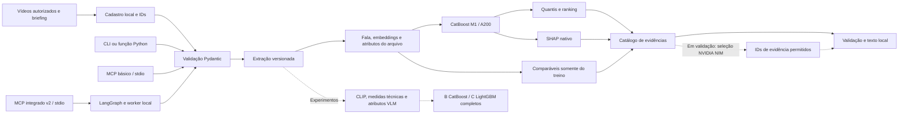

# 🧊 iSee

Análise preditiva de criativos antes da publicação.

Desenvolvido por **Leunam Sousa** para a **Galaxies**, no contexto da **Inteli Academy**. O nome combina a leitura de *I see* com o trocadilho visual de *ice*.

O iSee investiga uma escolha de quem produz conteúdo: entre vídeos ainda não publicados, qual vale priorizar em um teste de divulgação? Para isso, transforma características do conteúdo em entradas de um modelo estatístico e apresenta estimativas de visualizações, faixas, ordenação e evidências.

É um **serviço local em Python**, acessível por função, CLI e ferramentas **MCP por stdio**. A função, a CLI e o MCP básico chamam o mesmo analisador diretamente. Um segundo percurso, integrado na versão v2, usa LangGraph para organizar a análise e a explicação. A persona da Galaxies poderá consumir essa ferramenta; a construção da persona e a integração com a plataforma interna da empresa ficam fora deste projeto.

## Estado atual

O projeto está em fechamento do escopo. Há modelos treinados e percursos executados com dados reais, além de testes públicos com dados inventados. A avaliação final ainda não foi realizada.

| Parte | Evidência disponível | Limite atual |
| --- | --- | --- |
| M1 / A200 | CatBoost servido, quantis, SHAP e comparáveis; par independente Python/MCP v6 com três extrações por rota ([resultado](docs/issue-5-paridade-independente-resultados.md)) | Não comprova desempenho prospectivo ou retorno de patrocínio |
| A300 / B-cache / C-cache | Treino e comparação reais na validação; B/C-cache incluem CLIP e atributos técnicos | Não equivalem a B/C completos com atributos VLM aprovados |
| Explicação NVIDIA | Seleção real de IDs de evidência em exemplo inteiramente inventado, com renderer local | Cobertura parcial; aderência a uma campanha real não avaliada |
| Fluxo cacheado | Três casos reais passaram por previsão, SHAP, comparáveis e texto local | Começou em features preservadas; não executou mídia, MCP, StateGraph ou NIM nesse ensaio |
| VLM e avaliação final | Implementações, protocolos e resultados de diagnóstico preservados | Qualidade visual sem aprovação; teste de 31 casos reservado |

Os registros de execução anteriores continuam válidos para os contratos que cobriram. Abrir um resultado salvo consulta aquela execução; não repete a extração ou a previsão. O [guia de evidências](docs/entrega-20261021.md) distingue esses percursos. A [matriz de fechamento](docs/fechamento-20261023.md) registra os aceites restantes.

A [matriz detalhada](docs/fechamento-requisitos-e-evidencias.md) liga o TAPI e os acordos locais às evidências e às condições de aceite. O veredito é **parcialmente concluído**: os requisitos científicos abertos continuam obrigatórios. O [guia de seis minutos](docs/guia-explicacao-isee.md) ajuda a explicar o que acontece, como, onde e por quê.

O [recorte e texto de apresentação de 23/10](docs/entrega-apresentacao-20261023.md) descreve as pendências e os resultados reaproveitados. Com as dependências preparadas, a fachada local oferece estes percursos:

```bash
rtk proxy .venv/bin/python -B -m scripts.apresentacao mcp
rtk proxy .venv/bin/python -B -m scripts.apresentacao resultado
rtk proxy .venv/bin/python -B -m scripts.apresentacao metricas
```

O MCP usa entradas inventadas. `resultado` consulta somente a projeção pública de três previsões preservadas, sem ler features ou arquivos privados; `metricas` consulta agregados existentes de validação. A conferência final dos comandos será registrada na integração. O clone público não inclui vídeos, coortes, pesos ou bundles privados; após preparar as dependências, os percursos públicos com dados inventados funcionam offline.

Em 23/10, a tentativa diagnóstica v2 parou na criação de um namespace, antes de chamar o modelo. O [relatório da parada](docs/fechamento-frente-1-diagnostico-v2-resultados.md) preserva uma tentativa de preflight e zero chamadas de modelo.

Na [rodada v3 posterior](docs/fechamento-frente-1-ensaio-v3-resultados.md), o novo envelope externo permitiu a mesma cápsula isolada: um preflight e uma inferência concluída em 17,48 s, sem timeout e com limpeza confirmada. O VLM respondeu **`unknown` no positivo conhecido**. A execução técnica passou; a hipótese perceptiva continua inconclusiva. A rodada foi encerrada e o slot liberado, sem repetição ou liberação de atributos.

A [v4, revisão 2](docs/fechamento-frente-1-representacao-v4-resultados.md), autorizada separadamente, aumentou a escala visual e observou 1.056 tokens. A execução nativa completou em 60,305 s, mas a mesma sentinela positiva recebeu `unknown`. O STOP encerrou o painel após uma chamada; 16 casos não foram executados. A fila foi liberada após conferência dos recibos, processos e limpeza. O resultado não libera qualidade visual, extração elegível ou B/C completos.

A [ponte de B/C completos](docs/fechamento-frente-1-c-completo.md) tem código e testes sintéticos de pareamento, seleção, recarga e SHAP. Seu uso com dados observados exige liberação de qualidade e sidecars compatíveis; esses aceites continuam ausentes.

O [contrato V7](docs/fechamento-frente-1-contrato-v7.md) prepara os sete atributos e uma matriz de 912 colunas, preservando as 905 do B-cache. Seus 72 testes sintéticos passaram também na principal, após correções de documentação e tratamento de caminhos inválidos. O loader recusa cache observado sem a liberação correspondente; a conexão V7 aos treinos B/C e a validação perceptiva continuam pendentes.

A ponte de treino e comparação existente ainda usa o contrato de liberação anterior. Tipos, sidecars e carregamento V7 foram testados com dados sintéticos; a evolução dos treinos, artefatos e explicação para os sete atributos continua pendente. Contar sete campos em metadados não aprova percepção.

## Entrada e saída

O operador cadastra arquivos locais autorizados. Cada pedido usa de **um a cinco IDs distintos**, da mesma campanha e setor, acompanhados de:

- setor: `moda` ou `beleza`;
- objetivo: `divulgacao`;
- briefing: descrição textual da intenção da campanha.

Um candidato recebe análise individual; dois a cinco recebem comparação. Quando houver previsão disponível, a resposta contém q50, faixa q10–q90, versão do modelo e avisos de suporte. A comparação usa q50 para ordenar os candidatos. A camada de evidências pode acrescentar SHAP e referências semelhantes do treino.

O alvo é a contagem pública de views observada com **30 <= idade < 37 dias**. Não é a reconstrução das views exatamente no dia 30. Curtidas são informação retrospectiva, não entrada do próprio vídeo inédito. O briefing contextualiza o pedido; no M1 atual, ele não altera a previsão numérica.

## Arquitetura



As linhas pontilhadas mostram extensões experimentais ou sem aceite integrado. O grafo pertence ao percurso v2; não é executado pela CLI ou pelo MCP básico. Há evidência real histórica desse percurso com M1, mas o ensaio recente com três casos cacheados não executou o grafo nem o MCP. O servidor integrado atual não configura um provedor externo automaticamente.

Python reúne o processamento de mídia e as bibliotecas de ML. FFmpeg/ffprobe e PyAV tratam a mídia; faster-whisper transcreve a fala; MiniLM a representa numericamente. CatBoost e LightGBM permitem comparar modelos tabulares não lineares. CLIP e o VLM fazem parte da representação visual experimental. SHAP decompõe a previsão do modelo, sem atribuir causalidade.

Pydantic valida os contratos. FastMCP expõe a lógica por stdio, sem exigir uma API HTTP. LangGraph fica em um ambiente separado para preservar a compatibilidade do ambiente de extração e predição. A NVIDIA seleciona evidências permitidas; o validador e o renderer locais conservam os fatos e os números.

## Instalação

Requisitos: **Python 3.11**, `uv` e dependências do sistema necessárias ao processamento de mídia. Na raiz deste repositório:

```bash
uv sync --frozen
uv sync --project orchestration --frozen
```

A primeira instalação pode obter dependências da rede. Com o cache previamente preparado, acrescente `--offline`. Preserve os dois locks e os ambientes separados: `.venv/` e `orchestration/.venv/`. Não sincronize ambientes durante uma extração ou treinamento.

O [ensaio em dois ambientes novos](docs/issue-7-reproducao-offline.md) verificou Python 3.11.13, uv 0.11.16, FastMCP 4.1.0, CatBoost 1.2.10, LightGBM 4.7.0 e LangGraph 1.2.16 isolado. Os locks, e não apenas as faixas do `pyproject.toml`, identificam o conjunto de dependências. Essa prova histórica não foi repetida para preencher checklist; mudanças novas recebem verificações direcionadas.

O clone público não contém mídias, coortes privadas, pesos dos extratores ou bundles treinados. A previsão real depende desses recursos e de versões compatíveis. Os extratores não devem baixar ou substituir pesos silenciosamente durante uma análise. As revisões estão documentadas em [extratores e treino](docs/issue-1-extratores-e-treino.md).

Os operadores históricos de diagnóstico visual preservam caminhos absolutos e identidades do ambiente original para auditar rodadas seladas. Reproduzir esses ensaios exige preparar o ambiente e um protocolo próprio; alterar seus caminhos invalida os pins históricos. As interfaces de uso abaixo recebem os recursos explicitamente pelos argumentos documentados.

## Primeiro teste, sem dados privados

Depois de instalar as dependências, execute:

```bash
uv run --frozen python -m scripts.demo_creatives
```

O comando gera vídeos vazios temporários e compara as respostas da função Python e de um cliente MCP real. Não precisa de chave, mídia de terceiros ou modelo treinado. Nesse modo, a previsão fica explicitamente indisponível.

Para exercitar também uma referência numérica inventada:

```bash
uv run --frozen python -m scripts.demo_creatives --synthetic-baseline
```

Esse segundo modo testa contratos e transporte com **baseline sintético**. Seus números não são resultados de um modelo treinado em vídeos reais.

A mesma função pode ser chamada diretamente, sem pesos ou dados privados:

```python
from pathlib import Path
from tempfile import TemporaryDirectory

from scripts.creative_analysis import analyze_creatives
from scripts.creative_registry import CreativeRegistry
from scripts.demo_creatives import make_synthetic_video

with TemporaryDirectory() as directory:
    root = Path(directory)
    make_synthetic_video(root / "uploads" / "inventado.mp4")
    registry = CreativeRegistry(root / "uploads", root / "registry.json")
    registered = registry.register({
        "campaign_id": "exemplo", "sector": "beleza", "relative_path": "inventado.mp4"
    })
    response = analyze_creatives({
        "campaign_id": "exemplo", "sector": "beleza", "objective": "divulgacao",
        "brief": "Exemplo inteiramente inventado, sem campanha real.",
        "creative_ids": [registered["creative_id"]],
    }, registry, synthetic_baseline=True)
    print(response)
```

Esse exemplo usa o cadastro, gerador e analisador exercitados pela demonstração e pelos testes públicos existentes. Ele produz uma referência inventada e não executa M1, SHAP ou NVIDIA.

## Analisar um arquivo autorizado

Coloque o vídeo em `uploads/` e faça o cadastro local:

```bash
.venv/bin/python -m scripts.creative_cli register \
  --campaign-id minha-campanha \
  --sector beleza \
  --relative-path meu-video.mp4
```

Use o ID retornado para montar um pedido JSON privado com `campaign_id`, `sector`, `objective`, `brief` e `creative_ids`. O cadastro e o pedido devem usar a mesma campanha/setor. O [guia de reprodução](docs/guia-reproducao-local.md) detalha esse contrato.

Com o bundle M1 e sua coorte já disponíveis nos diretórios documentados:

```bash
.venv/bin/python -m scripts.creative_cli analyze \
  --request-file data/private/minha-campanha/request.json \
  --m1-model-dir artifacts/issue-3-experimento-a-v1 \
  --m1-cohort-dir data/private/issue-1-pool-treino-20261018-v6/released-cohort-v1
```

Esse comando exige arquivos reais existentes e autorizados; eles não vêm no clone público. A função compartilhada é `scripts.creative_analysis.analyze_creatives`, configurada com `CreativeRegistry` e `M1Settings`. Falhas de extração, idioma ou compatibilidade retornam estados explícitos, sem substituir silenciosamente o modelo.

## Usar pelo MCP

Configure o cliente MCP com transporte **stdio**, diretório de trabalho na raiz do repositório e o servidor:

```bash
.venv/bin/python -m scripts.creative_mcp \
  --m1-model-dir artifacts/issue-3-experimento-a-v1 \
  --m1-cohort-dir data/private/issue-1-pool-treino-20261018-v6/released-cohort-v1
```

A ferramenta se chama `analyze_creatives` e recebe o pedido no campo `payload`. O cliente inicia o processo e envia as mensagens MCP. Executar o servidor isoladamente deixa-o aguardando essas mensagens.

O percurso com grafo e pacote de evidências usa `scripts.explanation_graph_mcp_v2` e a ferramenta `analyze_creatives_with_explanation`. Ele exige `--graph-python` apontando para `orchestration/.venv/bin/python` e os recursos compatíveis descritos no [guia da integração nativa](docs/issue-5-integracao-nativa-v2.md). Esse percurso não implica que uma chamada NVIDIA real esteja configurada ou validada.

## Consultar uma explicação preservada

Defina `GALAXIES_REPORT_JSON` como o caminho de um relatório local autorizado e existente. Para apresentá-lo com o catálogo de evidências:

```bash
.venv/bin/python -B -m scripts.explanation_display \
  "$GALAXIES_REPORT_JSON" --show-local-evidence
```

O leitor confere os vínculos do relatório e distingue a seleção original do catálogo completo. Não calcula nova previsão, SHAP ou comparáveis e não chama a NVIDIA. A seleção pode estar ausente mesmo quando há evidências locais disponíveis.

A camada aditiva de revisão oferece também um exemplo público sem mídia, pesos ou chave:

```bash
.venv/bin/python -B -m scripts.explanation_review_mcp_v1 --public-example --format text
```

Esse caso tem briefing, observações e seleção local inteiramente inventados; não é uma resposta NVIDIA ou avaliação de campanha real. A tool optativa `analyze_creatives_reviewed` e a função `scripts.explanation_review_service_v1.analyze_reviewed` acrescentam revisão de fundamentos e de requisitos vinculados à mídia, preservando a resposta original. Consulte a [rubrica e configuração](docs/fechamento-frente-2-contrato-e-rubrica.md), inclusive a falha operacional ainda aberta na inicialização stdio sob um lançador supervisionado. A execução direta passou; a causa da diferença entre os lançadores não foi isolada. O adaptador usa o percurso histórico A200; a configuração final continua pendente.

## Dados, experimentos e resultados

A fonte é **YouTube Shorts de moda e beleza em português**, com metadados e contagens obtidos pela **YouTube Data API v3** e características extraídas da mídia. A coorte ampliada foi consolidada em **19/10/2026**. As datas de publicação e de observação de cada referência estão nos manifestos privados; a janela do alvo é de 30 a menos de 37 dias de idade. O intervalo completo de datas da coleta não foi recalculado nesta revisão.

A autorização da plataforma e o enquadramento de licenças e condições de uso não estão comprovados nos registros do projeto. A autorização operacional de coleta e a extração técnica não equivalem a essa aprovação. O [registro de origem e uso](docs/uso-youtube-e-plano-de-entrega.md) e a [curadoria final](docs/issue-1-curadoria-final.md) preservam essa pendência.

A coorte atual tem **300 referências de 166 canais**, com divisão **203 treino / 66 validação / 31 teste**. O modelo servido continua A200, treinado nos 124 exemplos de treino da coorte original de 200. A comparação ampliada não o substitui automaticamente.

Nos mesmos 66 exemplos e 37 canais de validação:

| Modelo | MAE log médio por canal |
| --- | ---: |
| A200, controle histórico servido | 1,7349 |
| A300 | 1,7761 |
| B-cache | 1,6584 |
| C-cache | 1,5444 |

Menor é melhor. A métrica mede erro em `log1p(views)`, com peso total igual por canal; não é acurácia nem erro contado em views. A validação também foi usada para selecionar hiperparâmetros. Esses números não são do teste final. O ganho agregado não é uniforme, e os casos de alto alcance continuam subestimados.

Os experimentos têm registro local com configurações, versões, hashes, modelos e recibos. Consulte:

- [Formulação e decisões técnicas](docs/proposta-tecnica.md).
- [Treinamento e comparação de A](docs/issue-3-treinamento-offline.md).
- [Experimento B-cache](docs/issue-4-experimento-b-resultados.md).
- [Comparação A300/B-cache/C-cache](docs/issue-4-experimento-c-cache-resultados.md).
- [Revisão das explicações](docs/issue-5-nim-quality-review-v1.md).
- [Procedimento da avaliação final](docs/issue-6-protocolo-final-e-checklist-v1.md).

Os comandos de treinamento dependem dos manifestos e caches privados identificados nesses protocolos. A abertura do teste reservado é uma etapa separada, com configuração congelada e autorização própria; não faz parte do teste de instalação.

## Treinamento e avaliação reproduzíveis

A versão do projeto continua `0.1.0`. Para reproduzir uma execução real, o operador precisa obter por passagem privada autorizada a coorte e seus manifestos, os caches vinculados aos hashes, as revisões dos extratores e os bundles. Esses recursos não possuem um endereço público de download neste repositório. Os caminhos e recibos completos ficam com o responsável pela base; não obter substitutos da rede ou atualizar hashes para contornar incompatibilidade.

Um comando de treino **já executado no experimento C-cache** e documentado com recarga exata é o seguinte, usando um destino novo em checkout compatível com as fontes congeladas:

```bash
env OPENBLAS_NUM_THREADS=1 OMP_NUM_THREADS=1 .venv/bin/python -B -m scripts.train_experiment_c_cache \
  --parent data/private/issue-1-pool-treino-20261018-v6/released-cohort-v1 \
  --cohort-dir data/private/issue-3-expansao-300-v1/released-cohort-v1 \
  --model-dir artifacts/issue-4-experimento-c-cache-reproducao \
  --comparison data/private/issue-4-experimento-c-cache-reproducao.json
```

O [relatório desse treino](docs/issue-4-experimento-c-cache-resultados.md) registra a configuração CPU1/threads1, as versões, o commit compatível e os resultados. Não iniciar o treino enquanto outra frente ocupa a fila. Esse comando usa os atributos cacheados sem VLM e não satisfaz B/C completos.

Para B/C completos, `scripts.run_full_models` oferece `inspect`, `train-b`, `train-c` e `compare`, com coortes, fila, liberação visual e destinos explícitos. O [contrato da ponte](docs/fechamento-frente-1-c-completo.md) documenta os argumentos e testes inventados. Os treinos completos reais continuam bloqueados pela liberação visual e não são anunciados como execução verificada.

O preflight atual da avaliação final pode ser conferido sem abrir os dados:

```bash
.venv/bin/python -B -m scripts.final_evaluation_preflight \
  --metadata docs/evidence/issue-6-final-readiness-v1.json
```

A saída esperada hoje é `blocked`, código **2**, com os aceites/identidades ausentes. É uma checagem de declarações. O [motor de métricas](docs/issue-6-motor-metricas-v1.md) e o [planejador temporal](docs/issue-6-diagnostico-temporal-v1.md) têm testes inventados; ainda faltam os carregadores restritos e os artefatos finais para o executor científico. Não há comando liberado que avalie os 31 casos agora. O diagnóstico temporal precisa ajustar modelos no anterior e avaliá-los no posterior; planejamento e datas não substituem esse resultado.

Antes da entrega final, congelar a configuração selecionada na validação, aceitar as Frentes 1/2, revisar o protocolo e obter autorização específica de abertura. Relatar erros, ranking, quantis, cobertura/largura, suporte e falhas sem retunar ou promover modelos pelo teste. Resultados negativos são parte do relatório.

## Privacidade e limites

Credenciais ficam fora de prompts, logs e Git. `.env.example` contém somente nomes de variáveis; a CLI local não carrega `.env` nem dispara APIs automaticamente. Os IDs da ferramenta fazem referência a um cadastro local, em vez de aceitar caminhos arbitrários do cliente.

Mídias, transcrições, dados e pesos permanecem fora do repositório público. Downloads concluídos não comprovam autorização de uso: origem, condições de uso, retenção e destinos permitidos precisam estar registrados. Conteúdo privado não deve ser enviado a um serviço externo sem autorização compatível.

As faixas q10–q90 são estimadas e não têm garantia automática de cobertura de 80%. Views públicas podem misturar alcance orgânico e pago. O projeto não demonstra causalidade, classificação universal de viralidade ou retorno de patrocínio. Aderência ao briefing, qualidade visual e avaliação final ainda têm aceites abertos.

## Verificações de desenvolvimento

Os testes públicos usam fixtures e não devem abrir o holdout ou iniciar chamadas externas:

```bash
.venv/bin/pytest -q --tb=short --show-capture=no
.venv/bin/ruff check scripts tests
.venv/bin/ruff format --check scripts tests
```

Combine a execução com os demais responsáveis antes de rodar a suíte completa. Testes de código, fidelidade matemática e qualidade preditiva são verificações diferentes. Os relatórios de 23/10 registram 114 checks e, em execução posterior à correção de apresentação, 22 testes; as contagens incluem casos repetidos entre as execuções.

O código preserva identificadores técnicos históricos com o prefixo `galaxies`. O nome público da solução é **iSee**; esses identificadores não foram renomeados para evitar invalidar contratos e artefatos existentes.
