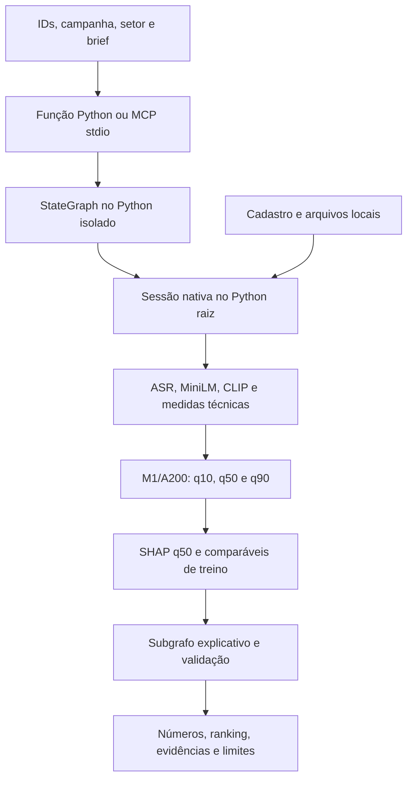

# Entrega — 21/10/2026

O protótipo analisa de um a cinco criativos de moda ou beleza para divulgação.
Um candidato recebe análise individual; dois a cinco recebem comparação, sempre
com campanha e setor comuns. O modelo servido é **M1/A200**, treinado com dados
reais, com estimativa q50, faixa q10–q90 e ranking por q50.

O alvo do experimento é views públicas observadas com idade entre 30 e menos de
37 dias. A avaliação disponível é exploratória; a faixa ainda não tem cobertura
final validada. As estimativas não comprovam viralidade, causalidade ou retorno
de patrocínio. A200 permanece servido; A300 e B-cache não foram promovidos.

## O que está demonstrado

| Frente | Pronto com evidência | Faltante | Próximo passo |
|---|---|---|---|
| Entrega utilizável | Três fontes reais; par Python/MCP atual integralmente igual em 159,816 s, com grafo, M1, SHAP e evidências | Integração real do provedor no grafo ainda não demonstrada | Apresentar o par atual, preservando o histórico e distinguindo a consulta em cache |
| Diagnóstico da divergência | Traces atuais iguais desde áudio/ASR até packet; histórico de 22 campos preservado | Causa antiga e intermediários históricos indisponíveis | Manter causa desconhecida e Python original canônico |
| Reprodução pública | Dois ambientes, CLI, StateGraph e MCP stdio verificados | Essa prova usa dados inventados | Mantê-la separada da demo real |
| NIM | Fixture tipada aceita fora do grafo; ligação offline verificada; chamada live no subgrafo retornou HTTP 200 | Seleção live rejeitada; `real_provider_verified=false` na demo e no novo recibo | Chamada única consumida; investigar somente offline antes de propor outra etapa |
| VLM e B/C | Falso positivo com/sem gramática e mantido com 1.056 tokens no negativo; execução espacial completa | Aprovação dos atributos e B/C completos; positivo em alta densidade não avaliado | Triagem científica em leitura; nenhuma candidata apoiada no recorte |
| M1 e avaliação final | A200 servido, treino e quantis com dados reais | Qualidade/faixa finais não validadas; teste reservado fechado | Manter o modelo atual e a avaliação final pendente de protocolo próprio |

Há trabalho com vídeos reais e arquivos de demonstração disponíveis sob retenção
limitada. Esta entrega conserva os resultados negativos e não encerra as issues
ou declara o escopo científico integral concluído.

## Arquitetura disponível



O serviço compartilhado é `scripts.explanation_graph_service_v2.analyze_via_graph`;
a ferramenta aditiva é `analyze_creatives_with_explanation`. O analisador
numérico e seus modos padrão/baselines/M1 continuam disponíveis. LangGraph fica
em `orchestration/`; o worker de extração e previsão usa o ambiente raiz.

O extrator compartilhado calcula ASR, MiniLM, CLIP e medidas técnicas, com VLM
desativado nesse percurso. **A200 recebe somente suas 388 colunas congeladas**
de fala, propriedades e setor; calcular CLIP não o torna parte desse preditor.
SHAP descreve contribuições em log1p(views); comparáveis são referências
descritivas exclusivamente do treino. Ambos preservam sua limitação causal.

O pacote local de evidências existe, mas o seletor externo do percurso real
permanece ausente: `real_provider_verified=false` e
`adherence_status=not_evaluated`, inclusive nas duas rotas atuais iguais.
O teste NIM tipado aceito usou uma fixture pública inventada, em operação
separada; não recebeu vídeos, features ou pacotes privados da demo. A
[ligação offline do seletor ao grafo](issue-5-nim-no-grafo-offline-v1.md) está
integrada e verificada com grafo/subgrafo compilados, worker raiz e resposta
HTTP falsa, inteiramente com dados inventados. Seu handoff nativo continua
falso e sua prova atual é `offline_only`. O serviço Python/MCP v2 permanece
sem provedor configurado; ainda não há chamada real encadeada nessa demonstração.

## Demo real: par atual e histórico preservado

O [par independente atual](issue-5-paridade-independente-resultados.md) executou
uma rota Python e uma MCP stdio completas em **159,816 s**. Ambas fizeram
StateGraph/subgrafo, três extrações, três previsões M1, SHAP, comparáveis e
packet vinculado. As respostas completas são iguais, sem normalização,
remoção de campos ou tolerância numérica. O hash comum é
`89a45573800d4da77584ba789437c77b5bb389932bbf73ad3dc5148e7864aba0`.

As 36 comparações de áudio/ASR/embedding/inputs foram iguais; quantis, SHAP,
comparáveis ordenados e packet também. Não foi observado estágio divergente
neste par. Limites respeitados e recolhimento confirmado, sem NIM, aquisição,
VLM gerativo ou abertura do teste. Essa prova vale para o par instrumentado,
as três peças e a configuração executada; não prova reprodução universal.

Um handoff privado adicional identifica esse par atual. Consultá-lo depois
é leitura offline de uma execução real concluída, sem nova inferência.
Ele não substitui o canônico Python original nem apaga o histórico abaixo.
A causa da divergência histórica continua desconhecida.

### Divergência histórica preservada

As três fontes distintas de beleza foram recuperadas uma vez, cadastradas e
analisadas por Python. O suplemento MCP corrigido reutilizou os mesmos arquivos,
pedido e configuração e produziu outras três previsões reais. Houve passagem
nativa de features, StateGraph, subgrafo e pacote de evidências nas duas rotas.

A comparação integral histórica falhou em **22 campos**. Duas das três entradas
diferem nos quantis servidos; a ordem do ranking é igual. As maiores diferenças absolutas
foram:

| Quantil | Diferença máxima em views |
|---|---:|
| q10 | 3,4939184904 |
| q50 | 56,2928475571 |
| q90 | 2.551,7943928820 |

Também diferem contribuições SHAP do grupo de fala e similaridades dos
comparáveis. Portanto, não é apenas texto ou hash de apresentação. A primeira
divergência observável está nos números da análise M1, antes do pacote;
**a primeira divergência interna e sua causa continuam desconhecidas**.
Vetores e digests intermediários não foram retidos. Não se atribuiu a causa
a ASR, embeddings, ordem ou aleatoriedade, nem se acrescentou tolerância.

As respostas originais continuam preservadas. O operador encerrou com
`native_python_mcp_mismatch`, sem repetir Python, a análise MCP corrigida ou a
aquisição. O resumo de sucesso e o handoff v3 condicionado à igualdade não
foram emitidos. A passagem privada posterior é utilizável, mas parcial e
identifica expressamente essa reprovação.

Fontes: [resultado das duas rotas](issue-5-demo-local-python-mcp-resultado.md) e
[diagnóstico offline](issue-5-divergencia-demo-diagnostico-offline.md).

O [diagnóstico frio único](issue-5-diagnostico-frio-unico-resultado.md) posterior
fez duas capturas isoladas e duas chamadas ao bundle em 39,87 s antes da limpeza
final: as nove famílias de digests foram iguais, assim como as previsões sobre
o mesmo vetor. A divergência histórica não foi reproduzida; sua causa continua
desconhecida. Esse caso isolado não aprovou paridade das rotas completas,
verificada posteriormente pelo par atual acima. O caso isolado/frio,
o overhead do perfilador e a afinidade a quatro CPUs limitam essa conclusão.
A autorização desse diagnóstico está consumida, sem outra rodada.

A [auditoria offline dos caminhos](issue-5-auditoria-offline-caminhos-resultado.md)
não demonstrou defeito de configuração efetiva, aliasing Python ou precisão do
transporte. Os dois relatórios reais já estavam internamente vinculados aos
respectivos pacotes: a diferença numérica precede o transporte externo. Os
casos inventados não provam determinismo das bibliotecas ou identificam causa.

O primeiro [par completo do trio](issue-5-par-trio-parada-operacional.md) parou
por falha operacional do helper, com zero extrações e zero bundles. Um
[par corrigido, com liberação própria](issue-5-par-trio-corrigido-resultados.md),
concluiu **dois lotes, seis extrações e seis chamadas ao bundle em 105,648 s**:
12 famílias nas três posições, **36 comparações iguais**, e delta máximo dos
quantis zero. Os objetos `analysis` dos dois lotes são iguais ao `analysis` do
MCP histórico e diferentes do Python original; isso não afirma igualdade dos
arquivos de resposta integrada ou dos pacotes de evidência completos.

O par não reexecutou grafo, SHAP ou transporte MCP, não recupera os vetores
históricos e não isola efeitos de CPU versus lote. O perfilador também acrescenta
overhead. **A causa original continua desconhecida; esse lote não comprovou
paridade das respostas integradas.** A prova atual das rotas completas é a
execução posterior descrita no início desta seção. Esse alinhamento não escolhe
uma fonte superior ou um reparo. A fonte da consulta canônica permanece o relatório Python original,
preservado sem substituição. Os diagnósticos estão encerrados, sem nova execução.

## Consulta histórica para apresentação

O apoio opt-in `get_canonical_demo_report` consulta o **relatório Python original
já preservado**, incluindo seu pacote de evidências. Uma consulta Python e uma
MCP real devolveram respostas completas iguais. Manifesto, origem e arquivos
estão vinculados a hashes auditados; pedido diferente, alteração, ausência,
symlink ou expiração recusam a consulta sem recalcular.

A consulta não verifica pesos atuais nem produz previsão nova. O envelope
separa o `report` original dos metadados `cache`, que deixam explícito:

```json
{
  "cache_hit": true,
  "origin": "preserved_native_python_report",
  "fresh_extraction": false,
  "fresh_stategraph": false,
  "fresh_provider_call": false,
  "report_flags_describe_historical_execution": true,
  "cold_run_exact_parity": false
}
```

Flags de extração/grafo dentro do relatório descrevem a execução histórica.
A igualdade dessas consultas **não substitui** execuções independentes.
O par atual igual e a divergência histórica permanecem documentados separadamente.
Não houve troca do relatório original, reparo numérico, chamada a
modelo ou nova explicação durante as duas leituras canônicas.

Ver [contrato, verificações e prova real da consulta](issue-5-consulta-canonica-demo.md).

## Ambientes, caches e comandos

Usar CPython 3.11 e os locks versionados. Há dois ambientes separados já
conferidos: `.venv/` na raiz, com 130 distribuições, e
`orchestration/.venv/`, com 42. O [ensaio de reprodução pública](issue-7-reproducao-offline.md)
documenta a instalação offline em ambientes novos, com caches próprios dos dois
locks e isolamento de rede. A estrutura de cache precisa incluir os arquivos
extraídos referidos pelos metadados; apenas copiar `wheels-v6` não basta.

Um clone público não contém bundle M1, coorte, encoders, mídia ou recibos privados.
O percurso nativo exige esses materiais locais nas revisões congeladas.
Ausência de cache não autoriza atualização de lock, instalação ou download
automático durante a apresentação. A preparação dos extratores está descrita em
[extratores e treino](issue-1-extratores-e-treino.md); os modos numéricos e seus
parâmetros estão no [guia local](guia-reproducao-local.md).

Na raiz de um checkout com os dois ambientes preparados, estes são comandos
públicos existentes e já documentados:

```sh
rtk proxy .venv/bin/python -B -m scripts.creative_cli --help
rtk proxy .venv/bin/python -B -m scripts.creative_cli schema analysis-input
rtk proxy .venv/bin/python -B -m docs.verification.issue7_public_smoke --output-dir data/private/entrega-20261021/prova-publica-01
```

O smoke exige diretório novo; escolher outro nome se já existir. Ele prova
Python/StateGraph/MCP com **dados inventados**, sem extração, chave, pesos
treinados ou chamada externa. Não é a demonstração real. Os comandos não foram
reexecutados na consolidação editorial.

Para consultar o resultado histórico, obter da passagem privada o diretório
de trabalho, o pedido, `PRIVATE_ROOT`, `MANIFEST` e `MANIFEST_SHA256`. Esses nomes
são parâmetros do operador, não campos aceitos no payload da ferramenta.
A função e seus argumentos foram exercitados uma vez; o exemplo abaixo mostra
seu uso, sem nova leitura realizada por este guia:

```python
import json
from pathlib import Path
from scripts.demo_canonical_report import CanonicalDemoSettings, get_canonical_demo_report

request = json.loads(Path(REQUEST_FILE).read_text())
settings = CanonicalDemoSettings(Path(PRIVATE_ROOT), Path(MANIFEST), MANIFEST_SHA256)
result = get_canonical_demo_report(request, settings)
```

O entrypoint MCP separado oferece somente a consulta histórica:

```sh
rtk proxy .venv/bin/python -B -m scripts.demo_canonical_mcp --root "$PRIVATE_ROOT" --manifest "$MANIFEST" --manifest-sha256 "$MANIFEST_SHA256"
```

O cliente stdio chama `get_canonical_demo_report` com `{"payload": request}`.
Esses argumentos do entrypoint foram exercitados na prova real stdio; não foi
criada configuração persistente de MCP no aplicativo. A passagem privada
distingue os argumentos efetivamente usados do comando Python equivalente que
não foi repetido como terceira consulta. Não reutilizar comandos ou marcadores
consumidos de aquisição, análise ou NIM para refazer esta entrega.

## Passagem privada e retenção

O operador dispõe de um recibo privado utilizável, modo **0600**, com os três
inputs, pedido/cadastro, configuração, duas respostas independentes, manifestos,
consultas preservadas, validade e comandos parametrizados. Solicitar essa
passagem privada à coordenação; seus caminhos, IDs e URLs de vídeos não fazem
parte deste guia ou do Git.

Os mesmos **três inputs** permanecem preservados sob novo lease até
**23/10/2026 às 23h59, America/Sao_Paulo** (`2026-10-24T02:59:00Z`), separados
do scratch removido após recolhimento. O controle vigente é
`retention-current.json`; o prazo antigo de 21/10 **não autoriza descarte**.
Antes de qualquer limpeza, foi instalado por criação exclusiva (`O_EXCL`)
o marcador `discard-started.json`, em estado `retention_hold` /
`discard_not_started`: ele bloqueia o descarte e não indica sua execução.
Não existe exclusão automática. O descarte continua sendo uma ação explícita
e coordenada do operador, conforme liberação, fase e processos recolhidos.

A **consulta canônica mantém validade até 21/10/2026 às 23h59,
America/Sao_Paulo** e recusa manifesto expirado. Essa validade não foi estendida
pelo novo lease dos inputs. Relatórios e manifestos históricos permanecem
intactos; a consulta não prorroga a retenção.

## Resultados científicos e limites a explicar

O [NIM sintético anterior](issue-5-nim-release-v1-resultados.md) recebeu HTTP 200, mas a
seleção foi rejeitada por `schema_invalid_type`. O campo exato não foi retido;
custo medido indisponível. O teto autorizado era R$0, sem retry. A tentativa
está consumida e não é um comando de reprodução a repetir na apresentação.

A [auditoria offline do NIM](issue-5-nim-schema-invalid-type-auditoria-offline.md)
conferiu 13 casos inventados: arrays JSON válidos são aceitos e não foi
comprovado bug de tupla/lista, parser ou coerção no caminho real. O código
agregado admite diferentes erros de tipo; sem o corpo remoto não se identifica
o formato concreto. Esse pedido, sua autoridade e os recibos rejeitados
permanecem preservados, sem reabrir a autorização consumida.

Uma autorização específica posterior permitiu o
[pedido tipado sintético](issue-5-nim-typed-request-v1-resultados.md), com schema
e tipos explícitos no texto, mesmo modelo/endpoint e autoridade inalterada.
Ele retornou **HTTP 200 e seleção aceita em 3,9023 s**, com 110 tokens e
878 bytes. O diagnóstico seguro confirmou hash string e array de IDs string.
Custo medido indisponível, teto autorizado R$0, sem retry; a nova tentativa
também está consumida. Isso valida esse contrato sintético fora do grafo,
sem provar a causa da rejeição antiga, aderência ou integração real da demo.

A ligação offline posterior foi integrada por unidade separada: 10 testes
raiz e 14 isolados passaram na principal, com uma seleção falsa entre contexto
e renderização do grafo original. A prova preserva números/ranking inventados
e flags falsas; o ramo remoto recusa antes de arquivos, chave ou conexão.
Isso não reutiliza o POST aceito, não é previsão real e não habilita HTTP novo.

O [candidato live integrado](issue-5-nim-no-grafo-live-v1.md) passou em mais
27 testes focados. A [primeira solicitação foi bloqueada pela revisão automática](issue-5-nim-no-grafo-live-bloqueio.md)
antes de criar processo, sem CLI, chave lida ou POST naquela ocasião. Esse
registro histórico e a revisão técnica permanecem preservados.

Após confirmação direta do usuário, a revisão permitiu a
[única chamada sintética no subgrafo](issue-5-nim-no-grafo-live-v1-resultados.md):
**HTTP 200 em 8,0073 s**, 262 tokens e 1.338 bytes. A seleção foi rejeitada pela
autoridade raiz (`selection_rejected`), sem campo exato ou corpo bruto retido;
a causa concreta continua desconhecida. Seleção/renderização não aceitas e
`real_provider_verified=false`. O processo terminou com recibo e zero workers.
Autorização consumida, teto R$0, custo medido indisponível; sem retry, reparo ou
caminho alternativo. Isso não altera a demonstração com mídia real nem o M1.

O [diagnóstico VLM](issue-4-vlm-pos-v16-pares-positivos-resultados.md) avaliou
cinco crops conhecidos de três vídeos de treino: quatro acertos com suporte
em `item_first`, zero em `state_first`, quatro perdas e nenhum ganho pareado.
Não foi auditoria independente. Gates preservados, VLM reprovado, sem atributos
liberados. O [diagnóstico direto posterior](issue-4-vlm-encoder-trace-resultados.md)
comprovou codificação e inserção de **100 tokens de imagem** em um positivo
conhecido. A lacuna dos logs foi localizada no mapeamento de verbosidade e
resolvida no adendo fechado. Isso prova o percurso visual nesse caso, sem
mostrar atenção, informação preservada ou qualidade perceptiva. O aviso de
grounding em 1.024 tokens não foi tratado como causa comprovada dos erros.

O [contraste real de percepção](issue-4-vlm-percepcao-gramatica-resultados.md)
concluiu quatro células em **25,8088 s** nos dois crops revelados da V14,
com mesma pergunta observável e contrato textual com/sem gramática. Todos os
formatos foram válidos: positivo `yes` e negativo `yes` nos dois modos,
sem abstenção. Retirar a gramática não corrigiu o falso positivo; nenhuma
candidata foi sustentada. Os quatro percursos visuais foram observados com
100 tokens por chamada. A fila está encerrada e nenhum saldo pode ser reusado.

O [diagnóstico espacial posterior](issue-4-vlm-espacial-1024-resultados.md), com
min/max de imagem em 1.024 e demais parâmetros iguais ao braço com gramática,
parou no negativo por timeout: **40,2631 s**, encoder concluído em 29,482 s,
cinco dos nove batches anunciados concluídos e nenhum stdout. Não houve
contagem visual completa nem resposta semântica; o positivo não foi chamado.
A limpeza foi confirmada, sem retry ou aumento de limites. A hipótese de
densidade ficou sem resposta nesse primeiro diagnóstico, e sua fila segue encerrada.

Uma [unidade negativa com orçamento próprio](issue-4-vlm-espacial-negativo-60-resultados.md)
preservou o mesmo argv espacial e permitiu até 55 s úteis. Concluiu em
**50,6565 s**, com JSON válido, retorno 0, **1.056 tokens visuais** e limpeza
confirmada. A resposta continuou `yes` no negativo esperado `no`. O aumento
de densidade foi observado, mas não corrigiu esse caso; não há candidata
sustentada. O positivo em alta densidade permanece não avaliado. A nova fila
também está encerrada, sem próximo ensaio automático ou aprovação de atributos.
B completo e C seguem bloqueados pelos gates e auditoria originais; o
[B-cache](issue-4-experimento-b-resultados.md) continua sendo comparação parcial
na validação, sem promoção ao serviço.

As partições da base de 300 são 203/66/31. O teste reservado não participou
da seleção e permanece fechado; não existe métrica final para apresentar
como resultado dessa avaliação. M1/A200, imagens e recibos anteriores foram
preservados. A avaliação final depende do protocolo e congelamento próprios.

Na apresentação: mostrar o par atual independente e o pacote preservado;
distinguir prova pública, demo real e consulta em cache; manter os 22 campos
históricos divergentes e sua causa desconhecida explícitos. Separar NIM
sintético aceito da integração real pendente; explicar gates VLM reprovados
e dependências B/C/teste final. O protótipo é
executável e tem evidências reais, com essas limitações declaradas. Não há
afirmação de cumprimento integral, acerto garantido ou encerramento de issues.
