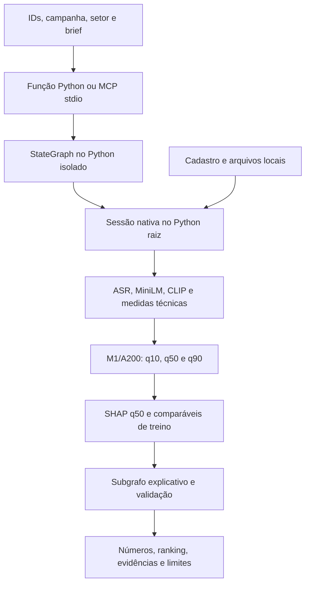

# Entrega — 21/10/2026

O protótipo analisa de um a cinco criativos de moda ou beleza para divulgação.
Um candidato recebe análise individual; dois a cinco recebem comparação, sempre
com campanha e setor comuns. O modelo servido é **M1/A200**, treinado com dados
reais, com estimativa q50, faixa q10–q90 e ranking por q50.

O alvo do experimento é views públicas observadas com idade entre 30 e menos de
37 dias. A avaliação disponível é exploratória; a faixa ainda não tem cobertura
final validada. As estimativas não comprovam viralidade, causalidade ou retorno
de patrocínio. A200 permanece servido; A300 e B-cache não foram promovidos.

## O que está demonstrado

| Frente | Pronto com evidência | Faltante | Próximo passo |
|---|---|---|---|
| Entrega utilizável | Três fontes reais; par Python/MCP atual integralmente igual em 159,816 s, com grafo, M1, SHAP e evidências | Integração real do provedor no grafo ainda não demonstrada | Apresentar o par atual, preservando o histórico e distinguindo a consulta em cache |
| Diagnóstico da divergência | Traces atuais iguais desde áudio/ASR até packet; histórico de 22 campos preservado | Causa antiga e intermediários históricos indisponíveis | Manter causa desconhecida e Python original canônico |
| Reprodução pública | Dois ambientes, CLI, StateGraph e MCP stdio verificados | Essa prova usa dados inventados | Mantê-la separada da demo real |
| NIM | V3 recebeu HTTP 200 e diagnosticou 21 IDs contra máximo de 12; dois HTTP 503 anteriores preservados | Seleção rejeitada no schema; `real_provider_verified=false`, aderência não avaliada | Autorizações consumidas; preservar recibos e não repetir |
| VLM e B/C | V2 confirmou falso positivo derivado com 1.075 tokens; v3 encerrou por timeout no derivado, após 6/9 lotes de decode | Comparação nativo/derivado incompleta; atributos e B/C completos não aprovados | Fila v3 selada, uma chamada consumida e três slots encerrados; sem repetir |
| M1 e avaliação final | A200 servido, treino e quantis com dados reais | Qualidade/faixa finais não validadas; teste reservado fechado | Manter o modelo atual e a avaliação final pendente de protocolo próprio |

Há trabalho com vídeos reais e arquivos de demonstração disponíveis sob retenção
limitada. Esta entrega conserva os resultados negativos e não encerra as issues
ou declara o escopo científico integral concluído.

## Roteiro verificável de 6–8 minutos

O percurso principal mostra **resultados reais já concluídos** e sua
proveniência. Não depende de nova aquisição, análise M1, chamada NIM ou geração
VLM durante a apresentação. A demonstração pública do protocolo usa fixture
inventada e fica identificada separadamente.

| Tempo | Mostrar | Evidência e interpretação |
| --- | --- | --- |
| 0:00–0:45 | Pedido preservado e contrato | Campanha, setor, objetivo, brief e três IDs na ordem original; suporte contratual de um a cinco candidatos, prova real atual com três peças de beleza |
| 0:45–2:45 | Uma resposta do par real v6 | q50, faixa q10–q90, ranking, SHAP e comparáveis; arquivo indicado pelo handoff privado, produzido por extração real independente em 21/10 |
| 2:45–3:30 | Recibo do par | Python/MCP completos iguais em 159,816 s; seis extrações e 36/36 comparações. Ler os arquivos agora é leitura offline, não outra inferência |
| 3:30–5:00 | Protocolo público e seu recibo | Ajuda/schema e smoke com fixture; processos Python/StateGraph/MCP reais, números inventados e nenhum modelo treinado carregado |
| 5:00–6:00 | Consulta canônica, se usada | Retorno preservado com envelope de cache explícito; fonte Python histórica, distinta do par v6. Nenhuma nova consulta é necessária para mostrar o recibo existente |
| 6:00–7:30 | Limites e próximos passos | NIM v3 rejeitado por exceder 12 IDs e visual v3 encerrado por timeout; VLM, B/C e teste final pendentes; datas diferentes de consulta e retenção |

Usar o recibo preservado da **prova pública única já concluída no código
`7ee0071`**. O comando de smoke abaixo documenta essa execução; não autoriza
repetição durante a apresentação. O resultado está registrado na conferência final.
O roteiro usa registros preservados, sem iniciar serviços ou modelos na
apresentação, mantendo explícita a origem inventada da prova de protocolo.

### Origem de cada evidência

| Origem | O que aconteceu | Como apresentar |
| --- | --- | --- |
| Par real v6 | Duas rotas completas fizeram extrações/previsões próprias e produziram respostas iguais | Prova de execução independente já concluída; abrir o relatório salvo não repete esse trabalho |
| Canônico histórico | Getter Python/MCP leu o mesmo relatório Python original, com manifesto e hashes | Cache explícito: `cache_hit=true`, `fresh_* = false`; flags internas do relatório descrevem o passado, e `cold_run_exact_parity=false` permanece |
| Fixture pública | Mesmo protocolo/grafo com números e evidências inventados | Prova funcional do contrato/IPC, com `native_feature_handoff=false` e `real_provider_verified=false`; não é previsão real |

A resposta Python histórica canônica difere do par v6 e não foi substituída.
A causa da divergência permanece desconhecida. Manter o rótulo da fonte ao
mostrar números, sem misturar as duas respostas. O serviço numérico
`creative_cli analyze` e o serviço integrado
`analyze_creatives_with_explanation` podem executar M1, mas não são leitores de
cache. Reutilizar o protocolo v6 consumido não faz parte deste roteiro nem
autoriza outra execução. Isso não impede consertos locais dentro do escopo.

### Pedido e localizadores do operador

Obter os valores na passagem privada, sem publicá-los no Git:

| Parâmetro | Uso |
| --- | --- |
| `CHECKOUT` | Diretório de trabalho indicado pelo operador, com os dois ambientes preparados |
| `REQUEST_FILE` | Pedido real preservado: `campaign_id`, `sector`, `objective`, `brief` e `creative_ids` na ordem original |
| `REPORT_PYTHON` / `REPORT_MCP` | Duas respostas completas do par v6, localizadas no handoff desse par |
| `PRIVATE_ROOT`, `MANIFEST`, `MANIFEST_SHA256` | Configuração exclusiva do leitor canônico histórico |
| `NEW_PUBLIC_PROOF_DIR` | Destino privado que era novo na prova final; execução já consumida, com recibos disponíveis na passagem do operador |

Não inventar IDs nem editar o brief/ordem para consultar o canônico. Seu payload
é o pedido completo de `REQUEST_FILE`; o cliente MCP o envia como
`{"payload": request}`. Caminhos de arquivos/modelos são configuração do
operador, não campos desse pedido. O schema público abaixo permite conferir a
forma do contrato sem revelar valores privados. O brief contextualiza a
campanha; não retreina o modelo nem muda seu alvo.

## Arquitetura disponível



O serviço compartilhado é `scripts.explanation_graph_service_v2.analyze_via_graph`;
a ferramenta aditiva é `analyze_creatives_with_explanation`. O analisador
numérico e seus modos padrão/baselines/M1 continuam disponíveis. LangGraph fica
em `orchestration/`; o worker de extração e previsão usa o ambiente raiz.

O extrator compartilhado calcula ASR, MiniLM, CLIP e medidas técnicas, com VLM
desativado nesse percurso. **A200 recebe somente suas 388 colunas congeladas**
de fala, propriedades e setor; calcular CLIP não o torna parte desse preditor.
SHAP descreve contribuições em log1p(views); comparáveis são referências
descritivas exclusivamente do treino. Ambos preservam sua limitação causal.

O pacote local de evidências existe, mas o seletor externo do percurso real
permanece ausente: `real_provider_verified=false` e
`adherence_status=not_evaluated`, inclusive nas duas rotas atuais iguais.
O teste NIM tipado aceito usou uma fixture pública inventada, em operação
separada; não recebeu vídeos, features ou pacotes privados da demo. A
[ligação offline do seletor ao grafo](issue-5-nim-no-grafo-offline-v1.md) está
integrada e verificada com grafo/subgrafo compilados, worker raiz e resposta
HTTP falsa, inteiramente com dados inventados. Seu handoff nativo continua
falso e sua prova atual é `offline_only`. O serviço Python/MCP v2 permanece
sem provedor configurado; ainda não há chamada real encadeada nessa demonstração.

## Demo real: par atual e histórico preservado

O [par independente atual](issue-5-paridade-independente-resultados.md) executou
uma rota Python e uma MCP stdio completas em **159,816 s**. Ambas fizeram
StateGraph/subgrafo, três extrações, três previsões M1, SHAP, comparáveis e
packet vinculado. As respostas completas são iguais, sem normalização,
remoção de campos ou tolerância numérica. O hash comum é
`89a45573800d4da77584ba789437c77b5bb389932bbf73ad3dc5148e7864aba0`.

As 36 comparações de áudio/ASR/embedding/inputs foram iguais; quantis, SHAP,
comparáveis ordenados e packet também. Não foi observado estágio divergente
neste par. Limites respeitados e recolhimento confirmado, sem NIM, aquisição,
VLM gerativo ou abertura do teste. Essa prova vale para o par instrumentado,
as três peças e a configuração executada; não prova reprodução universal.

Um handoff privado adicional identifica esse par atual. Consultá-lo depois
é leitura offline de uma execução real concluída, sem nova inferência.
Ele não substitui o canônico Python original nem apaga o histórico abaixo.
A causa da divergência histórica continua desconhecida.

### Divergência histórica preservada

As três fontes distintas de beleza foram recuperadas uma vez, cadastradas e
analisadas por Python. O suplemento MCP corrigido reutilizou os mesmos arquivos,
pedido e configuração e produziu outras três previsões reais. Houve passagem
nativa de features, StateGraph, subgrafo e pacote de evidências nas duas rotas.

A comparação integral histórica falhou em **22 campos**. Duas das três entradas
diferem nos quantis servidos; a ordem do ranking é igual. As maiores diferenças absolutas
foram:

| Quantil | Diferença máxima em views |
|---|---:|
| q10 | 3,4939184904 |
| q50 | 56,2928475571 |
| q90 | 2.551,7943928820 |

Também diferem contribuições SHAP do grupo de fala e similaridades dos
comparáveis. Portanto, não é apenas texto ou hash de apresentação. A primeira
divergência observável está nos números da análise M1, antes do pacote;
**a primeira divergência interna e sua causa continuam desconhecidas**.
Vetores e digests intermediários não foram retidos. Não se atribuiu a causa
a ASR, embeddings, ordem ou aleatoriedade, nem se acrescentou tolerância.

As respostas originais continuam preservadas. O operador encerrou com
`native_python_mcp_mismatch`, sem repetir Python, a análise MCP corrigida ou a
aquisição. O resumo de sucesso e o handoff v3 condicionado à igualdade não
foram emitidos. A passagem privada posterior é utilizável, mas parcial e
identifica expressamente essa reprovação.

Fontes: [resultado das duas rotas](issue-5-demo-local-python-mcp-resultado.md) e
[diagnóstico offline](issue-5-divergencia-demo-diagnostico-offline.md).

O [diagnóstico frio único](issue-5-diagnostico-frio-unico-resultado.md) posterior
fez duas capturas isoladas e duas chamadas ao bundle em 39,87 s antes da limpeza
final: as nove famílias de digests foram iguais, assim como as previsões sobre
o mesmo vetor. A divergência histórica não foi reproduzida; sua causa continua
desconhecida. Esse caso isolado não aprovou paridade das rotas completas,
verificada posteriormente pelo par atual acima. O caso isolado/frio,
o overhead do perfilador e a afinidade a quatro CPUs limitam essa conclusão.
A autorização desse diagnóstico está consumida, sem outra rodada.

A [auditoria offline dos caminhos](issue-5-auditoria-offline-caminhos-resultado.md)
não demonstrou defeito de configuração efetiva, aliasing Python ou precisão do
transporte. Os dois relatórios reais já estavam internamente vinculados aos
respectivos pacotes: a diferença numérica precede o transporte externo. Os
casos inventados não provam determinismo das bibliotecas ou identificam causa.

O primeiro [par completo do trio](issue-5-par-trio-parada-operacional.md) parou
por falha operacional do helper, com zero extrações e zero bundles. Um
[par corrigido, com liberação própria](issue-5-par-trio-corrigido-resultados.md),
concluiu **dois lotes, seis extrações e seis chamadas ao bundle em 105,648 s**:
12 famílias nas três posições, **36 comparações iguais**, e delta máximo dos
quantis zero. Os objetos `analysis` dos dois lotes são iguais ao `analysis` do
MCP histórico e diferentes do Python original; isso não afirma igualdade dos
arquivos de resposta integrada ou dos pacotes de evidência completos.

O par não reexecutou grafo, SHAP ou transporte MCP, não recupera os vetores
históricos e não isola efeitos de CPU versus lote. O perfilador também acrescenta
overhead. **A causa original continua desconhecida; esse lote não comprovou
paridade das respostas integradas.** A prova atual das rotas completas é a
execução posterior descrita no início desta seção. Esse alinhamento não escolhe
uma fonte superior ou um reparo. A fonte da consulta canônica permanece o relatório Python original,
preservado sem substituição. Os diagnósticos estão encerrados, sem nova execução.

## Consulta histórica para apresentação

O apoio opt-in `get_canonical_demo_report` consulta o **relatório Python original
já preservado**, incluindo seu pacote de evidências. Uma consulta Python e uma
MCP real devolveram respostas completas iguais. Manifesto, origem e arquivos
estão vinculados a hashes auditados; pedido diferente, alteração, ausência,
symlink ou expiração recusam a consulta sem recalcular.

A consulta não verifica pesos atuais nem produz previsão nova. O envelope
separa o `report` original dos metadados `cache`, que deixam explícito:

```json
{
  "cache_hit": true,
  "origin": "preserved_native_python_report",
  "fresh_extraction": false,
  "fresh_stategraph": false,
  "fresh_provider_call": false,
  "report_flags_describe_historical_execution": true,
  "cold_run_exact_parity": false
}
```

Flags de extração/grafo dentro do relatório descrevem a execução histórica.
A igualdade dessas consultas **não substitui** execuções independentes.
O par atual igual e a divergência histórica permanecem documentados separadamente.
Não houve troca do relatório original, reparo numérico, chamada a
modelo ou nova explicação durante as duas leituras canônicas.

Ver [contrato, verificações e prova real da consulta](issue-5-consulta-canonica-demo.md).

## Ambientes, caches e comandos

Usar CPython 3.11 e os locks versionados. Há dois ambientes separados já
conferidos: `.venv/` na raiz, com 130 distribuições, e
`orchestration/.venv/`, com 42. O [ensaio de reprodução pública](issue-7-reproducao-offline.md)
documenta a instalação offline em ambientes novos, com caches próprios dos dois
locks e isolamento de rede. A estrutura de cache precisa incluir os arquivos
extraídos referidos pelos metadados; apenas copiar `wheels-v6` não basta.

Um clone público não contém bundle M1, coorte, encoders, mídia ou recibos privados.
O percurso nativo exige esses materiais locais nas revisões congeladas.
Ausência de cache não autoriza atualização de lock, instalação ou download
automático durante a apresentação. A preparação dos extratores está descrita em
[extratores e treino](issue-1-extratores-e-treino.md); os modos numéricos e seus
parâmetros estão no [guia local](guia-reproducao-local.md).

Na raiz de um checkout com os dois ambientes preparados, estes são comandos
públicos existentes e já documentados:

```sh
rtk proxy .venv/bin/python -B -m scripts.creative_cli --help
rtk proxy .venv/bin/python -B -m scripts.creative_cli schema analysis-input
rtk proxy .venv/bin/python -B -m docs.verification.issue7_public_smoke --output-dir "$NEW_PUBLIC_PROOF_DIR"
```

O smoke exige diretório novo; não escolher outro nome para repetir a prova
consumida deste marco. Ele prova
Python/StateGraph/MCP com **dados inventados**, sem extração, chave, pesos
treinados ou chamada externa. Não é a demonstração real. Os comandos não foram
reexecutados na consolidação editorial. Executar a partir de `CHECKOUT`, com
`NEW_PUBLIC_PROOF_DIR` definido conforme a tabela acima. Não instalar ou
sincronizar ambientes durante o ensaio. Os guias anteriores documentam seus
checkpoints; esta página reúne o estado operacional atual.

Para consultar o resultado histórico, obter da passagem privada o diretório
de trabalho, o pedido, `PRIVATE_ROOT`, `MANIFEST` e `MANIFEST_SHA256`. Esses nomes
são parâmetros do operador, não campos aceitos no payload da ferramenta.
A função e seus argumentos foram exercitados uma vez; o exemplo abaixo mostra
seu uso, sem nova leitura realizada por este guia:

```python
import json
from pathlib import Path
from scripts.demo_canonical_report import CanonicalDemoSettings, get_canonical_demo_report

request = json.loads(Path(REQUEST_FILE).read_text())
settings = CanonicalDemoSettings(Path(PRIVATE_ROOT), Path(MANIFEST), MANIFEST_SHA256)
result = get_canonical_demo_report(request, settings)
```

O entrypoint MCP separado oferece somente a consulta histórica:

```sh
rtk proxy .venv/bin/python -B -m scripts.demo_canonical_mcp --root "$PRIVATE_ROOT" --manifest "$MANIFEST" --manifest-sha256 "$MANIFEST_SHA256"
```

O cliente stdio chama `get_canonical_demo_report` com `{"payload": request}`.
Esses argumentos do entrypoint foram exercitados na prova real stdio; não foi
criada configuração persistente de MCP no aplicativo. A passagem privada
distingue os argumentos efetivamente usados do comando Python equivalente que
não foi repetido como terceira consulta. Iniciar somente o servidor o deixa
aguardando mensagens do cliente; não produz uma análise. O comando acima é do
leitor histórico, não do servidor que executa extração M1. Não reutilizar comandos ou marcadores
consumidos de aquisição, análise ou NIM para refazer esta entrega.

## Passagem privada e retenção

O operador dispõe de um recibo privado utilizável, modo **0600**, com os três
inputs, pedido/cadastro, configuração, duas respostas independentes, manifestos,
consultas preservadas, validade e comandos parametrizados. Solicitar essa
passagem privada à coordenação; seus caminhos, IDs e URLs de vídeos não fazem
parte deste guia ou do Git.

Os mesmos **três inputs** permanecem preservados sob novo lease até
**23/10/2026 às 23h59, America/Sao_Paulo** (`2026-10-24T02:59:00Z`), separados
do scratch removido após recolhimento. O controle vigente é
`retention-current.json`; o prazo antigo de 21/10 **não autoriza descarte**.
Antes de qualquer limpeza, foi instalado por criação exclusiva (`O_EXCL`)
o marcador `discard-started.json`, com `retention_hold=true` e
`discard_not_started=true`: ele bloqueia o descarte e não indica sua execução.
O lease não agenda exclusão e o bloqueio não expira nem se remove
automaticamente. O plano/comando antigo não deve ser usado para apagar os
inputs por expiração em 21/10; uma limpeza futura exige revisão operacional
explícita, preservando as condições e os processos recolhidos.

A **consulta canônica mantém validade até 21/10/2026 às 23h59,
America/Sao_Paulo** e recusa manifesto expirado. Essa validade não foi estendida
pelo novo lease dos inputs. Relatórios e manifestos históricos permanecem
intactos; a consulta não prorroga a retenção.

## Resultados científicos e limites a explicar

O [NIM sintético anterior](issue-5-nim-release-v1-resultados.md) recebeu HTTP 200, mas a
seleção foi rejeitada por `schema_invalid_type`. O campo exato não foi retido;
custo medido indisponível. O teto autorizado era R$0, sem retry. A tentativa
está consumida e não é um comando de reprodução a repetir na apresentação.

A [auditoria offline do NIM](issue-5-nim-schema-invalid-type-auditoria-offline.md)
conferiu 13 casos inventados: arrays JSON válidos são aceitos e não foi
comprovado bug de tupla/lista, parser ou coerção no caminho real. O código
agregado admite diferentes erros de tipo; sem o corpo remoto não se identifica
o formato concreto. Esse pedido, sua autoridade e os recibos rejeitados
permanecem preservados, sem reabrir a autorização consumida.

Uma autorização específica posterior permitiu o
[pedido tipado sintético](issue-5-nim-typed-request-v1-resultados.md), com schema
e tipos explícitos no texto, mesmo modelo/endpoint e autoridade inalterada.
Ele retornou **HTTP 200 e seleção aceita em 3,9023 s**, com 110 tokens e
878 bytes. O diagnóstico seguro confirmou hash string e array de IDs string.
Custo medido indisponível, teto autorizado R$0, sem retry; a nova tentativa
também está consumida. Isso valida esse contrato sintético fora do grafo,
sem provar a causa da rejeição antiga, aderência ou integração real da demo.

A ligação offline posterior foi integrada por unidade separada: 10 testes
raiz e 14 isolados passaram na principal, com uma seleção falsa entre contexto
e renderização do grafo original. A prova preserva números/ranking inventados
e flags falsas; o ramo remoto recusa antes de arquivos, chave ou conexão.
Isso não reutiliza o POST aceito, não é previsão real e não habilita HTTP novo.

O [candidato live integrado](issue-5-nim-no-grafo-live-v1.md) passou em mais
27 testes focados. A [primeira solicitação foi bloqueada pela revisão automática](issue-5-nim-no-grafo-live-bloqueio.md)
antes de criar processo, sem CLI, chave lida ou POST naquela ocasião. Esse
registro histórico e a revisão técnica permanecem preservados.

Após confirmação direta do usuário, a revisão permitiu a
[única chamada sintética no subgrafo](issue-5-nim-no-grafo-live-v1-resultados.md):
**HTTP 200 em 8,0073 s**, 262 tokens e 1.338 bytes. A seleção foi rejeitada pela
autoridade raiz (`selection_rejected`), sem campo exato ou corpo bruto retido;
a causa concreta continua desconhecida. Seleção/renderização não aceitas e
`real_provider_verified=false`. O processo terminou com recibo e zero workers.
Autorização consumida, teto R$0, custo medido indisponível; sem retry, reparo ou
caminho alternativo. Isso não altera a demonstração com mídia real nem o M1.

O [novo adaptador HTTP diagnóstico inerte](issue-5-nim-adaptador-diagnostico-inerte-v1.md)
foi integrado e passou em **17 testes raiz e 16 isolados** na principal.
Reutiliza o transporte, o grafo/subgrafo e a autoridade original; o diagnóstico
seguro é observado depois da aceitação/rejeição, sem alterá-la. Isso prepara
a observação de uma eventual próxima resposta, não recupera a resposta antiga.
Esse candidato inerte permanece com **`AUTHORIZATION_ID=None`**,
`remote_execution_released=false` e `remaining_authorized_calls=0`.
O caminho remoto recusa antes dos efeitos; fakes mantêm flags de provedor falso.
A [release diagnóstica separada foi executada uma vez](issue-5-nim-diagnostic-release-v1-resultados.md),
após nova autorização e revisão técnica: **HTTP 503**, diagnóstico `http_error`
na fase `transport`, autoridade não invocada e provedor não validado. Terminou
em 1,2829 s com cleanup confirmado; números/ranking preservados. Bytes/tokens
não registrados e custo medido indisponível. Autorização consumida, sem repetir;
isso não configura provedor no percurso real v6 nem explica a rejeição histórica.

A [liberação NIM v2 posterior](issue-5-nim-recovery-release-v2-resultados.md),
autorizada separadamente, também terminou com **um POST/HTTP 503**, em **1,3159 s**.
Diagnóstico `transport/http_error`, autoridade não invocada, seleção/renderização
não aceitas e aderência não avaliada. Limpeza confirmada, zero workers e
números/ranking preservados. A nova autorização está consumida; não houve retry.
Bytes/tokens e custo medido permanecem indisponíveis. A causa específica do 503
não foi identificada; não se atribui quota, indisponibilidade global ou schema.

O [NIM v3 ligado ao worker e grafo](issue-5-nim-worker-diagnostic-v3-resultados.md)
fez um POST autorizado separado: **HTTP 200**, 1.340 bytes/262 tokens e **8,0903 s**.
A seleção trouxe **21 IDs contra máximo de 12** no contrato e no schema enviado;
diagnóstico `schema/schema_constraint`, tipos corretos, IDs conhecidos, sem
duplicatas e hash igual. Seleção/renderização rejeitadas, aderência não avaliada,
provedor não validado. Limpeza confirmada, números/ranking preservados e autorização
consumida. Essa violação atual não identifica causas das rejeições históricas.

O [diagnóstico VLM](issue-4-vlm-pos-v16-pares-positivos-resultados.md) avaliou
cinco crops conhecidos de três vídeos de treino: quatro acertos com suporte
em `item_first`, zero em `state_first`, quatro perdas e nenhum ganho pareado.
Não foi auditoria independente. Gates preservados, VLM reprovado, sem atributos
liberados. O [diagnóstico direto posterior](issue-4-vlm-encoder-trace-resultados.md)
comprovou codificação e inserção de **100 tokens de imagem** em um positivo
conhecido. A lacuna dos logs foi localizada no mapeamento de verbosidade e
resolvida no adendo fechado. Isso prova o percurso visual nesse caso, sem
mostrar atenção, informação preservada ou qualidade perceptiva. O aviso de
grounding em 1.024 tokens não foi tratado como causa comprovada dos erros.

O [contraste real de percepção](issue-4-vlm-percepcao-gramatica-resultados.md)
concluiu quatro células em **25,8088 s** nos dois crops revelados da V14,
com mesma pergunta observável e contrato textual com/sem gramática. Todos os
formatos foram válidos: positivo `yes` e negativo `yes` nos dois modos,
sem abstenção. Retirar a gramática não corrigiu o falso positivo; nenhuma
candidata foi sustentada. Os quatro percursos visuais foram observados com
100 tokens por chamada. A fila está encerrada e nenhum saldo pode ser reusado.

O [diagnóstico espacial posterior](issue-4-vlm-espacial-1024-resultados.md), com
min/max de imagem em 1.024 e demais parâmetros iguais ao braço com gramática,
parou no negativo por timeout: **40,2631 s**, encoder concluído em 29,482 s,
cinco dos nove batches anunciados concluídos e nenhum stdout. Não houve
contagem visual completa nem resposta semântica; o positivo não foi chamado.
A limpeza foi confirmada, sem retry ou aumento de limites. A hipótese de
densidade ficou sem resposta nesse primeiro diagnóstico, e sua fila segue encerrada.

Uma [unidade negativa com orçamento próprio](issue-4-vlm-espacial-negativo-60-resultados.md)
preservou o mesmo argv espacial e permitiu até 55 s úteis. Concluiu em
**50,6565 s**, com JSON válido, retorno 0, **1.056 tokens visuais** e limpeza
confirmada. A resposta continuou `yes` no negativo esperado `no`. O aumento
de densidade foi observado, mas não corrigiu esse caso; não há candidata
sustentada. O positivo em alta densidade permanece não avaliado. A nova fila
também está encerrada, sem próximo ensaio automático ou aprovação de atributos.
B completo e C seguem bloqueados pelos gates e auditoria originais; o
[B-cache](issue-4-experimento-b-resultados.md) continua sendo comparação parcial
na validação, sem promoção ao serviço.

A [recuperação nativa posterior](issue-4-vlm-fonte-nativa-recuperacao-resultados.md)
concluiu **duas tentativas e dois frames em 12,1893 s**, sem geração VLM ou NIM.
A ponte reproduziu propriedades, PTS, folhas e crops congelados antes de reter
os frames RGB 360×640. Os bytes dos contêineres diferiram dos históricos;
o resultado não afirma identidade nativa histórica nem melhora perceptiva.
Os vídeos temporários foram removidos após os acks, com zero workers/scratch.
Somente os dois PNGs novos e recibos ficaram retidos até **hoje, 21/10 às 23h59**;
esse prazo é distinto do lease dos três vídeos da demo, até 23/10.

O [primeiro contraste nativo versus derivado foi interrompido](issue-4-vlm-contraste-nativo-interrupcao.md)
após uma reserva, sem resposta recuperável. A fila está selada e as três células
não utilizadas foram encerradas; não houve repetição. A causa permanece
desconhecida. Scratch e recibos foram preservados, sem confirmação histórica
de cleanup; zero workers foram observados na reconciliação. Os 260 s cobrados
conservadoramente não são tempo medido. Não há comparação perceptiva entre os
braços ou aceite de atributos. Auditoria independente, gates e lote uniforme
continuam necessários ao B/C completos.

A [nova comparação v2 com captura durável](issue-4-vlm-contraste-nativo-v2-resultados.md)
encerrou após **duas chamadas em 109,0818 s**. O negativo derivado respondeu
`yes` com 1.075 tokens e decode completo; o negativo nativo terminou por timeout,
sem resposta, após 7/9 lotes de decode. Os positivos não foram executados.
Ambos os recibos foram preservados, com limpeza confirmada e zero workers/scratch
v2. A fila está selada, sem saldo ou repetição. Não há comparação pareada completa,
nova aprovação perceptiva ou causa identificada para a diferença de tempo.
O journaling comprovou persistência operacional dos dois recibos; a percepção
continua reprovada e as causas das interrupções anteriores permanecem desconhecidas.

O [diagnóstico offline visual](issue-4-vlm-gargalo-offline-v1.md) localizou o
timeout nativo no decode da imagem: encoder de 38,417 s e 13,705 s em 7/9 lotes
concluídos, com 896 tokens; reduzir o limite de geração não resolve essa fase.
O [observador HTTP aditivo](issue-5-nim-http-error-observation-v1.md) ganhou ligação
ao [worker e grafo NIM v3](issue-5-nim-worker-diagnostic-v3.md): os dois smoke tests
de integração, com respostas inventadas 200/503, passaram em 4,887 s, com limpeza,
zero HTTP real e diagnóstico do erro sem leitura de corpo. Isso não recupera a
causa dos 503 nem valida o provedor real. O [contraste visual v3](issue-4-vlm-contraste-nativo-v3-proposta.md)
foi preparado offline com quatro PNGs congelados, limites propostos de 80 s por
dispatch/340 s globais e plano lógico
`39ec99f9783e91a99adc063d61541261aea4f62baaaae429b70c31d4c6f36dd3`.
A [rodada visual v3 posteriormente autorizada](issue-4-vlm-contraste-nativo-v3-resultados.md)
encerrou na primeira célula, por timeout: **76,5429 s** globais, encoder de
51,620 s e 6/9 lotes de decode concluídos, sem resposta. A fila foi selada e os
três slots restantes encerrados, com limpeza confirmada e zero workers/scratch
v3. O limite maior não garantiu conclusão; não há comparação pareada nova ou
causa demonstrada para a variação temporal. As duas autorizações específicas da
rodada foram consumidas. Chamadas atualmente autorizadas: **zero**, sem repetição.

As partições da base de 300 são 203/66/31. O teste reservado não participou
da seleção e permanece fechado; não existe métrica final para apresentar
como resultado dessa avaliação. M1/A200, imagens e recibos anteriores foram
preservados. A avaliação final depende do protocolo e congelamento próprios.

Na apresentação: mostrar o par atual independente e o pacote preservado;
distinguir prova pública, demo real e consulta em cache; manter os 22 campos
históricos divergentes e sua causa desconhecida explícitos. Separar NIM
sintético aceito da integração real pendente; explicar gates VLM reprovados
e dependências B/C/teste final. O protótipo é
executável e tem evidências reais, com essas limitações declaradas. Não há
afirmação de cumprimento integral, acerto garantido ou encerramento de issues.

## Conferência final e condição de entrega

Base da revisão anterior do roteiro: `6a2ca66fee3c58a920f705a1d904bd45fc9dfab5`.
Somente este guia foi alterado em branch isolada. Os comandos e resultados
citados têm suas provas anteriores; não foram reexecutados por causa da prosa.
Naquela unidade editorial não houve consulta canônica, smoke, modelo, serviço, instalação,
aquisição ou modificação de retenção.

Após a integração, a **prova pública única concluiu com saída 0 em 21/10/2026**,
no código `7ee007162660787e451760ec04f304b13036c77e`: paridade integral
Python/MCP, três mensagens JSON-RPC válidas, sentinela ausente, scratch vazio
e workers recolhidos. Foram três candidatos inteiramente inventados, com
`native_feature_handoff=false`, `real_provider_verified=false` e
`adherence_status=not_evaluated`, sem extração, modelo treinado ou HTTP.
Recibo SHA-256: `bce0e7b4cc296654d24258ec4deeebf4c95c337de11dedf7bbba89e44e3e022e`.

O wire JSON-RPC foi **validado, mas não retido**:
`jsonrpc_wire_validated=true`, `jsonrpc_wire_retained=false`. Foram preservados
somente o recibo, stdout agregado e stderr, separados do fluxo RPC original.
O runtime isolado do módulo não foi medido. A validação limita-se ao protocolo
com fixture; não houve consulta canônica, VLM ou NIM nessa prova. Esta nota não
reexecutou a prova nem acrescentou testes. As pendências científicas permanecem.

O pacote é uma entrega parcial verificável: fonte e locks, evidências públicas
e roteiro, com passagem privada separada. O aceite integral do escopo continua
dependente das pendências declaradas. Não há relatório científico final ou
declaração de projeto 100% concluído nesta consolidação.
