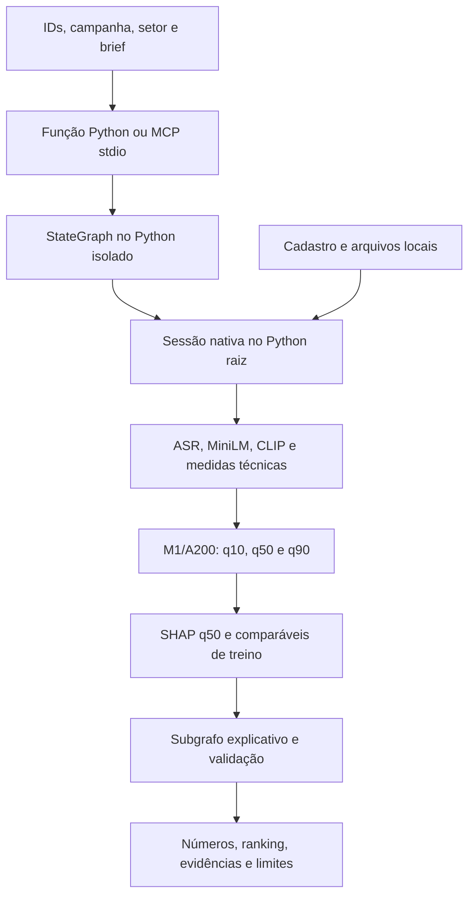

# Entrega — 21/10/2026

O protótipo analisa de um a cinco criativos de moda ou beleza para divulgação.
Um candidato recebe análise individual; dois a cinco recebem comparação, sempre
com campanha e setor comuns. O modelo servido é **M1/A200**, treinado com dados
reais, com estimativa q50, faixa q10–q90 e ranking por q50.

O alvo do experimento é views públicas observadas com idade entre 30 e menos de
37 dias. A avaliação disponível é exploratória; a faixa ainda não tem cobertura
final validada. As estimativas não comprovam viralidade, causalidade ou retorno
de patrocínio. A200 permanece servido; A300 e B-cache não foram promovidos.

## O que está demonstrado

| Frente | Pronto com evidência | Faltante | Próximo passo neste encerramento |
|---|---|---|---|
| Entrega utilizável | Três fontes reais atuais, M1, SHAP, evidências e consulta histórica opt-in em cache | Igualdade independente: 22 campos divergentes | Apresentar os dois resultados e os metadados do cache |
| Diagnóstico da divergência | Audits offline e dois lotes nativos consistentes | Causa interna e diagnósticos históricos intermediários do encoder | Preservar a falha aberta; nenhum patch causal comprovado |
| Reprodução pública | Dois ambientes, CLI, StateGraph e MCP stdio verificados | Essa prova usa dados inventados | Mantê-la separada da demo real |
| NIM | HTTP 200 em 2,63 s, 762 bytes e 91 tokens; rejeição `schema_invalid_type` | Corpo não retido; seleção não validada; sem bug de parser comprovado | Autorização consumida; nenhum novo envio |
| VLM e B/C | VLM 4/5 versus 0/5 reprovado; B-cache parcial com CLIP e medidas técnicas | Gates VLM e B/C completos continuam bloqueados | Registrar pendências, sem nova rodada ou correção causal concreta |
| M1 e avaliação final | A200 servido, treino e quantis com dados reais | Qualidade/faixa finais não validadas; teste reservado fechado | Manter o modelo atual e a avaliação final pendente de protocolo próprio |

Há trabalho com vídeos reais e arquivos de demonstração disponíveis sob retenção
limitada. Esta entrega conserva os resultados negativos e não encerra as issues
ou declara o escopo científico integral concluído.

## Arquitetura disponível



O serviço compartilhado é `scripts.explanation_graph_service_v2.analyze_via_graph`;
a ferramenta aditiva é `analyze_creatives_with_explanation`. O analisador
numérico e seus modos padrão/baselines/M1 continuam disponíveis. LangGraph fica
em `orchestration/`; o worker de extração e previsão usa o ambiente raiz.

O extrator compartilhado calcula ASR, MiniLM, CLIP e medidas técnicas, com VLM
desativado nesse percurso. **A200 recebe somente suas 388 colunas congeladas**
de fala, propriedades e setor; calcular CLIP não o torna parte desse preditor.
SHAP descreve contribuições em log1p(views); comparáveis são referências
descritivas exclusivamente do treino. Ambos preservam sua limitação causal.

O pacote local de evidências existe, mas o seletor externo do percurso real
permanece ausente: `real_provider_verified=false` e
`adherence_status=not_evaluated`. O teste NIM usou uma fixture pública inventada,
em operação separada; não recebeu vídeos, features ou pacotes privados da demo.

## Demo real: resultado independente e limite conhecido

As três fontes distintas de beleza foram recuperadas uma vez, cadastradas e
analisadas por Python. O suplemento MCP corrigido reutilizou os mesmos arquivos,
pedido e configuração e produziu outras três previsões reais. Houve passagem
nativa de features, StateGraph, subgrafo e pacote de evidências nas duas rotas.

A comparação integral falhou em **22 campos**. Duas das três entradas diferem
nos quantis servidos; a ordem do ranking é igual. As maiores diferenças absolutas
foram:

| Quantil | Diferença máxima em views |
|---|---:|
| q10 | 3,4939184904 |
| q50 | 56,2928475571 |
| q90 | 2.551,7943928820 |

Também diferem contribuições SHAP do grupo de fala e similaridades dos
comparáveis. Portanto, não é apenas texto ou hash de apresentação. A primeira
divergência observável está nos números da análise M1, antes do pacote;
**a primeira divergência interna e sua causa continuam desconhecidas**.
Vetores e digests intermediários não foram retidos. Não se atribuiu a causa
a ASR, embeddings, ordem ou aleatoriedade, nem se acrescentou tolerância.

As respostas originais continuam preservadas. O operador encerrou com
`native_python_mcp_mismatch`, sem repetir Python, a análise MCP corrigida ou a
aquisição. O resumo de sucesso e o handoff v3 condicionado à igualdade não
foram emitidos. A passagem privada posterior é utilizável, mas parcial e
identifica expressamente essa reprovação.

Fontes: [resultado das duas rotas](issue-5-demo-local-python-mcp-resultado.md) e
[diagnóstico offline](issue-5-divergencia-demo-diagnostico-offline.md).

O [diagnóstico frio único](issue-5-diagnostico-frio-unico-resultado.md) posterior
fez duas capturas isoladas e duas chamadas ao bundle em 39,87 s antes da limpeza
final: as nove famílias de digests foram iguais, assim como as previsões sobre
o mesmo vetor. A divergência histórica não foi reproduzida; sua causa continua
desconhecida e a paridade independente permanece reprovada. O caso isolado/frio,
o overhead do perfilador e a afinidade a quatro CPUs limitam essa conclusão.
A autorização desse diagnóstico está consumida, sem outra rodada.

A [auditoria offline dos caminhos](issue-5-auditoria-offline-caminhos-resultado.md)
não demonstrou defeito de configuração efetiva, aliasing Python ou precisão do
transporte. Os dois relatórios reais já estavam internamente vinculados aos
respectivos pacotes: a diferença numérica precede o transporte externo. Os
casos inventados não provam determinismo das bibliotecas ou identificam causa.

O primeiro [par completo do trio](issue-5-par-trio-parada-operacional.md) parou
por falha operacional do helper, com zero extrações e zero bundles. Um
[par corrigido, com liberação própria](issue-5-par-trio-corrigido-resultados.md),
concluiu **dois lotes, seis extrações e seis chamadas ao bundle em 105,648 s**:
12 famílias nas três posições, **36 comparações iguais**, e delta máximo dos
quantis zero. Os objetos `analysis` dos dois lotes são iguais ao `analysis` do
MCP histórico e diferentes do Python original; isso não afirma igualdade dos
arquivos de resposta integrada ou dos pacotes de evidência completos.

O par não reexecutou grafo, SHAP ou transporte MCP, não recupera os vetores
históricos e não isola efeitos de CPU versus lote. O perfilador também acrescenta
overhead. **A causa original continua desconhecida e a paridade independente
não foi aprovada.** Esse alinhamento não escolhe uma fonte superior ou um
reparo. A fonte da consulta canônica permanece o relatório Python original,
preservado sem substituição. Os diagnósticos estão encerrados, sem nova execução.

## Consulta histórica para apresentação

O apoio opt-in `get_canonical_demo_report` consulta o **relatório Python original
já preservado**, incluindo seu pacote de evidências. Uma consulta Python e uma
MCP real devolveram respostas completas iguais. Manifesto, origem e arquivos
estão vinculados a hashes auditados; pedido diferente, alteração, ausência,
symlink ou expiração recusam a consulta sem recalcular.

A consulta não verifica pesos atuais nem produz previsão nova. O envelope
separa o `report` original dos metadados `cache`, que deixam explícito:

```json
{
  "cache_hit": true,
  "origin": "preserved_native_python_report",
  "fresh_extraction": false,
  "fresh_stategraph": false,
  "fresh_provider_call": false,
  "report_flags_describe_historical_execution": true,
  "cold_run_exact_parity": false
}
```

Flags de extração/grafo dentro do relatório descrevem a execução histórica.
A igualdade dessas consultas **não substitui** a comparação independente
reprovada. Não houve troca do relatório original, reparo numérico, chamada a
modelo ou nova explicação durante as duas leituras canônicas.

Ver [contrato, verificações e prova real da consulta](issue-5-consulta-canonica-demo.md).

## Ambientes, caches e comandos

Usar CPython 3.11 e os locks versionados. Há dois ambientes separados já
conferidos: `.venv/` na raiz, com 130 distribuições, e
`orchestration/.venv/`, com 42. O [ensaio de reprodução pública](issue-7-reproducao-offline.md)
documenta a instalação offline em ambientes novos, com caches próprios dos dois
locks e isolamento de rede. A estrutura de cache precisa incluir os arquivos
extraídos referidos pelos metadados; apenas copiar `wheels-v6` não basta.

Um clone público não contém bundle M1, coorte, encoders, mídia ou recibos privados.
O percurso nativo exige esses materiais locais nas revisões congeladas.
Ausência de cache não autoriza atualização de lock, instalação ou download
automático durante a apresentação. A preparação dos extratores está descrita em
[extratores e treino](issue-1-extratores-e-treino.md); os modos numéricos e seus
parâmetros estão no [guia local](guia-reproducao-local.md).

Na raiz de um checkout com os dois ambientes preparados, estes são comandos
públicos existentes e já documentados:

```sh
rtk proxy .venv/bin/python -B -m scripts.creative_cli --help
rtk proxy .venv/bin/python -B -m scripts.creative_cli schema analysis-input
rtk proxy .venv/bin/python -B -m docs.verification.issue7_public_smoke --output-dir data/private/entrega-20261021/prova-publica-01
```

O smoke exige diretório novo; escolher outro nome se já existir. Ele prova
Python/StateGraph/MCP com **dados inventados**, sem extração, chave, pesos
treinados ou chamada externa. Não é a demonstração real. Os comandos não foram
reexecutados na consolidação editorial.

Para consultar o resultado histórico, obter da passagem privada o diretório
de trabalho, o pedido, `PRIVATE_ROOT`, `MANIFEST` e `MANIFEST_SHA256`. Esses nomes
são parâmetros do operador, não campos aceitos no payload da ferramenta.
A função e seus argumentos foram exercitados uma vez; o exemplo abaixo mostra
seu uso, sem nova leitura realizada por este guia:

```python
import json
from pathlib import Path
from scripts.demo_canonical_report import CanonicalDemoSettings, get_canonical_demo_report

request = json.loads(Path(REQUEST_FILE).read_text())
settings = CanonicalDemoSettings(Path(PRIVATE_ROOT), Path(MANIFEST), MANIFEST_SHA256)
result = get_canonical_demo_report(request, settings)
```

O entrypoint MCP separado oferece somente a consulta histórica:

```sh
rtk proxy .venv/bin/python -B -m scripts.demo_canonical_mcp --root "$PRIVATE_ROOT" --manifest "$MANIFEST" --manifest-sha256 "$MANIFEST_SHA256"
```

O cliente stdio chama `get_canonical_demo_report` com `{"payload": request}`.
Esses argumentos do entrypoint foram exercitados na prova real stdio; não foi
criada configuração persistente de MCP no aplicativo. A passagem privada
distingue os argumentos efetivamente usados do comando Python equivalente que
não foi repetido como terceira consulta. Não reutilizar comandos ou marcadores
consumidos de aquisição, análise ou NIM para refazer esta entrega.

## Passagem privada e retenção

O operador dispõe de um recibo privado utilizável, modo **0600**, com os três
inputs, pedido/cadastro, configuração, duas respostas independentes, manifestos,
consultas preservadas, validade e comandos parametrizados. Solicitar essa
passagem privada à coordenação; seus caminhos, IDs e URLs de vídeos não fazem
parte deste guia ou do Git.

Os inputs permanecem retidos até **21/10/2026 às 23h59, São Paulo**, separados
do scratch removido após recolhimento. **Não apagar os inputs agora:** a criação
da passagem não significa apresentação concluída. Não existe timer ou expurgo
automático prometido. O descarte continua sendo uma ação explícita e coordenada
do operador, conforme liberação, fase e confirmação de processos recolhidos.
A consulta não prorroga a retenção e recusa manifesto expirado.

## Resultados científicos e limites a explicar

O [NIM sintético](issue-5-nim-release-v1-resultados.md) recebeu HTTP 200, mas a
seleção foi rejeitada por `schema_invalid_type`. O campo exato não foi retido;
custo medido indisponível. O teto autorizado era R$0, sem retry. A tentativa
está consumida e não é um comando de reprodução a repetir na apresentação.

A [auditoria offline do NIM](issue-5-nim-schema-invalid-type-auditoria-offline.md)
conferiu 13 casos inventados: arrays JSON válidos são aceitos e não foi
comprovado bug de tupla/lista, parser ou coerção no caminho real. O código
agregado admite diferentes erros de tipo; sem o corpo remoto não se identifica
o formato concreto. A autorização consumida impede validar uma mudança no
fornecedor agora. Pedido, payload, schema e autoridade permanecem iguais.

O [diagnóstico VLM](issue-4-vlm-pos-v16-pares-positivos-resultados.md) avaliou
cinco crops conhecidos de três vídeos de treino: quatro acertos com suporte
em `item_first`, zero em `state_first`, quatro perdas e nenhum ganho pareado.
Não foi auditoria independente. Gates preservados, VLM reprovado, sem atributos
liberados. Não há diagnósticos internos retidos do encoder visual que comprovem
uma causa ou correção concreta. B completo e C seguem bloqueados; o
[B-cache](issue-4-experimento-b-resultados.md) continua sendo comparação parcial
na validação, sem promoção ao serviço.

As partições da base de 300 são 203/66/31. O teste reservado não participou
da seleção e permanece fechado; não existe métrica final para apresentar
como resultado dessa avaliação. M1/A200, imagens e recibos anteriores foram
preservados. A avaliação final depende do protocolo e congelamento próprios.

Na apresentação: mostrar o fluxo e o pacote preservado; distinguir prova
pública de demo real; expor os 22 campos divergentes e os metadados do cache;
explicar NIM/VLM reprovados e as dependências B/C/teste final. O protótipo é
executável e tem evidências reais, com essas limitações declaradas. Não há
afirmação de cumprimento integral, acerto garantido ou encerramento de issues.
