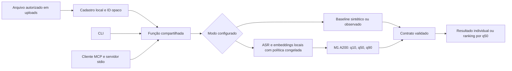

# Reprodução local do percurso disponível

Checkpoint de 20/10/2026, preparação da #7. O percurso disponível é cadastro →
baseline ou M1/A200 → função Python, CLI e MCP stdio. B-cache é uma comparação
offline; VLM ainda está em desenvolvimento. Este guia não declara concluídas
as issues #4–#7 nem substitui o relatório final da #6.

## Ambiente e arquivos necessários

Use Python 3.11 e o `uv.lock` versionado. Na raiz do checkout, com as dependências
já presentes no cache local:

```bash
rtk proxy uv sync --frozen --offline
rtk proxy .venv/bin/python -m scripts.creative_cli --help
rtk proxy .venv/bin/python -m scripts.creative_cli schema analysis-input
```

Sem cache, a primeira instalação exige obter as dependências antes de processar
mídia privada. As revisões dos pesos locais estão descritas em
[extratores e treino](issue-1-extratores-e-treino.md). A inferência M1 trabalha
offline e não baixa pesos ausentes. Não atualize o lock, versões ou fontes
congeladas para contornar um erro de compatibilidade; o bundle verifica esses
vínculos. Não sincronize o ambiente durante uma extração em andamento.

| Modo | Configuração e material local |
| --- | --- |
| Padrão | Sem bundle; retorna indisponibilidade explícita de previsão. |
| Baseline sintético | `--synthetic-baseline`; estatísticas inventadas, identificadas como sintéticas. |
| Baseline observado | `--observed-baseline-dir` e o bundle privado liberado correspondente. |
| M1 | Juntos `--m1-model-dir artifacts/issue-3-experimento-a-v1` e `--m1-cohort-dir data/private/issue-1-pool-treino-20261018-v6/released-cohort-v1`. |

Os modos são mutuamente exclusivos. Dados, mídias, registros e modelos privados
não estão no Git; um clone público não contém o bundle observado nem M1. Não
use uma base fictícia ou outro artefato como substituto silencioso. A
[conferência técnica de M1](https://github.com/leeunam/case-GALAXIES-IA/blob/0df616e5fd64dfc4947abde583f2664b66abf410/docs/issue-3-conclusao-tecnica-local.md) identifica o
bundle servido e suas limitações.

## Cadastro e chamada

Coloque um vídeo próprio/licenciado ou autorizado para o ensaio em `uploads/`.
Use mídia de demonstração fora do teste reservado. O cadastro recebe caminho
relativo à pasta permitida; a análise recebe apenas o ID retornado:

```bash
rtk proxy .venv/bin/python -m scripts.creative_cli register \
  --campaign-id demo-local --sector beleza --relative-path meu-video.mp4
```

Crie um JSON local privado, por exemplo `data/private/demo-local/request.json`,
com `campaign_id="demo-local"`, `sector="beleza"`, `objective="divulgacao"`,
um `brief` não vazio e `creative_ids` contendo o ID `cr_…` retornado pelo
cadastro. São permitidos de um a cinco IDs distintos da mesma campanha/setor.
Não invente um ID nem forneça caminhos de arquivos/modelos no payload.

```bash
rtk proxy .venv/bin/python -m scripts.creative_cli analyze \
  --request-file data/private/demo-local/request.json --synthetic-baseline
```

Para o M1 real, com pesos e bundles já disponíveis:

```bash
rtk proxy .venv/bin/python -m scripts.creative_cli analyze \
  --request-file data/private/demo-local/request.json \
  --m1-model-dir artifacts/issue-3-experimento-a-v1 \
  --m1-cohort-dir data/private/issue-1-pool-treino-20261018-v6/released-cohort-v1
```

Uma entrada gera análise individual; duas a cinco geram comparação quando
todas as previsões estiverem disponíveis. Empates recebem a mesma posição.
Falha de extração/idioma, ausência de fala sem suporte no treino ou bundle
incompatível deixam a estimativa indisponível; não há fallback de modelo.
O brief contextualiza a solicitação, sem alterar a previsão calculada.

## Função e MCP

A função é `scripts.creative_analysis.analyze_creatives(payload, registry,
m1=settings)`, com `CreativeRegistry` e `M1Settings` configurados pelo operador.
O [registro da integração](issue-3-servico-m1.md) contém o exemplo Python e os
contratos detalhados.

Para um cliente MCP, configure transporte **stdio**, diretório de trabalho na
raiz do checkout e este comando de servidor:

```bash
rtk proxy .venv/bin/python -m scripts.creative_mcp \
  --m1-model-dir artifacts/issue-3-experimento-a-v1 \
  --m1-cohort-dir data/private/issue-1-pool-treino-20261018-v6/released-cohort-v1
```

O cliente inicia o processo e chama `analyze_creatives` com `payload` igual ao
da função. Executar o servidor sozinho deixa-o aguardando mensagens MCP; isso
não é uma resposta de análise. Cadastro continua sendo operação local. stdout
é reservado ao protocolo; o adaptador não publica mídias/transcrições nos logs.



SHAP, comparáveis e subgrafo explicador NIM são trabalho da #5, sem conexão ao
percurso acima neste checkpoint. Um template determinístico não equivale a
chamada de LLM ou a `StateGraph`.

## Verificação e roteiro de demonstração

Sem coletar mídia nem abrir dados de teste:

```bash
rtk proxy .venv/bin/pytest -q --tb=short --show-capture=no
rtk proxy .venv/bin/ruff check scripts tests
rtk proxy .venv/bin/ruff format --check scripts tests
```

Na conferência posterior à parada v9, a suíte passou em 624 testes em 317,65 s,
com Ruff/formatação dos 112 arquivos aprovados.
Os comandos de ajuda e exportação do schema deste guia foram executados sem
mídia/modelo. Não houve reinstalação, nova demo real ou nova execução do teste
reservado para redigir o documento.

Para demonstrar: cadastrar um criativo externo à avaliação; verificar estado,
q50 e faixa; acrescentar outros dois e observar ranking/empates; exercitar uma
falha suportada; conferir a mesma resposta por Python/MCP. A utilidade genérica
`demo_m1` reproduz paridade para 1/2/5 cadastros, conforme os comandos do
[relatório de serviço](issue-3-servico-m1.md), mas cópias de um arquivo não
equivalem a três criativos diferentes. A nova demonstração integrada da #5,
com três arquivos, explicação e evidências, continua pendente.

O alvo é views públicas observadas entre 30 e menos de 37 dias, retrospectivo
na amostra disponível; não é previsão prospectiva comprovada nem estimativa
de retorno de patrocínio. A faixa não tem cobertura validada, e o exemplo
externo de milhões foi fortemente subestimado. Preservar o teste fechado até
o congelamento aprovado e as dependências de #6; não executar avaliação final
como smoke test de instalação. O relatório final, a demo integrada e a
explicação pelo aluno continuam necessários para concluir a entrega.
