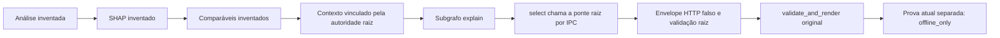

# Issue #5 — ligação NIM ao grafo, unidade exclusivamente offline

Unidade local aprovada em 21/10/2026. A autorização externa restante é **zero**.
Não houve HTTP real, leitura de chave, reserva de ledger remoto, instalação,
carregamento de modelo, mídia ou dados privados. A árvore principal não foi
alterada. A chamada aceita anterior continua consumida e não é reapresentada
como prova deste caminho.

## O que esta unidade demonstra

O `build_graph` de `integrated_graph_v2.py` e seu subgrafo compilado são os
originais, sem alteração de arquivo, nó, transição, flags ou autoridade:



O grafo isolado chama o Python raiz já existente. A ponte aditiva delega as cinco
operações originais à `explanation_session_v2.Session`; acrescenta somente
`select` entre contexto e renderização, e `proof` após a renderização. São sete
mensagens limitadas, sem execução de ferramentas escolhidas pelo modelo.
O seletor admite uma única invocação. Um pacote diferente do público selado é
recusado antes até do transporte falso, consumindo a transição local.

A ponte reutiliza o framing e a ponte de resposta existentes. O conteúdo
original do envelope falso chega primeiro a `validate_selection`, sem coerção.
Somente uma seleção validada de IDs públicos conhecidos atravessa o IPC; corpo,
cabeçalhos, nomes/valores desconhecidos e seus hashes não atravessam. O render
original valida novamente a seleção canônica e conserva integralmente análise,
ranking, evidências e limites. Falhas produzem explicação incompleta.

## Origem dos dados e fronteira raiz

A fixture pública nova contém três criativos, previsões de **137, 283 e 211
views**, faixas, contribuições SHAP agrupadas e uma referência por candidato.
Todos os números, IDs, fingerprints, datas e referências são inventados.
Os dados foram construídos a partir da estrutura de fixture pública existente,
com novos valores e identidades, sem abrir qualquer mídia ou artefato privado.
Há 24 fatos no pacote e nove IDs na seleção falsa válida. As URLs de referência
usam `example.invalid` e ficam fora do pedido ao provedor.

O teste usa callbacks explícitos para análise, SHAP e índice inventados dentro
da sessão raiz real. Não usa os loaders de modelo/treino. O valor simulado
`training_samples=124` satisfaz a guarda estrutural existente; não é uma consulta
ao treino real. `native_feature_handoff=false` permanece verdadeiro como descrição
da execução, e `numerical_origin=entirely_invented` identifica o envelope novo.
O único input admitido para análise é `{}`; IDs de arquivos, briefs ou dados reais
não podem ser interpretados como entrada desta sonda.

O grafo e o worker usam código do clone e os dois interpretadores já disponíveis,
sem instalar ou sincronizar ambientes. O ambiente do worker é o literal do
cliente integrado original, sem chave, proxy ou tracing herdados. O adaptador
retém o handle durante spawn, protege recolhimento contra cancelamento repetido
e encerra/recolhe seu único worker antes de sair. Não cria netos, modelos ou
arquivos de scratch. O prazo total, incluindo spawn e IPC, é de até 45 s.

## Contrato da prova e compatibilidade

A saída nova `creative-nim-graph-offline-v1` contém:

- `legacy_result`: resultado original v2 intacto, incluindo sua declaração
  literal `orchestration.real_provider_verified=false`;
- `current_provider`: origem `offline_fake`, ID efêmero desta execução, hash
  público do pacote, sequência das sete operações, contagem de um seletor,
  metadados limitados de transporte, aceitação raiz e verificação atual falsa.

A prova tem de corresponder ao ID desta execução, pacote selado, resultado,
aceitação e ordem das operações. Origem live forjada, hash divergente, recibo
de outra execução, dispatch em cache ou contagem real diferente de zero são
recusados. Um HTTP 200 falso aceito continua com `verification_status=offline_only`
e `real_provider_verified=false`. Não há argumento para carregar recibo anterior.

O serviço Python/MCP v2 continua sem provedor configurado. Esta unidade é um
entrypoint local aditivo de verificação do mesmo grafo; não declara que a API MCP
v2 passou a executar NIM. Uma futura liberação real exigirá adição revisada com
autorização específica, vínculo de checkout, consumo exclusivo e dispatch real
desta execução, além de resposta HTTP válida, pacote correto e autoridade aceita.
Não basta alterar o literal antigo ou reapresentar o POST aceito anterior.

## Verificação realizada

Passaram **10 testes raiz em 0,76 s** e **14 testes isolados em 11,04 s**,
somente desta unidade. A suíte anterior de 140 testes não foi repetida.
Os testes verificam StateGraph/subgrafo realmente compilados, worker raiz por
IPC, uma seleção entre contexto e render, números/ranking/afirmações estáveis,
recusa de pacote e seleção divergentes, supressão de sentinelas inventadas,
timeout, cancelamento no seletor e cancelamento repetido durante spawn sem
liberar trabalho. Os workers dos testes foram encerrados e recolhidos.

O ramo `remote_exchange()` recusa incondicionalmente **antes de ler fixture,
criar diretório, reservar ledger, acessar credencial ou abrir conexão**. O teste
torna a leitura/criação de arquivos proibida e confirma essa recusa. Não há
cliente HTTP real ou namespace remoto novo nesta unidade.

Ruff e formatação passaram nos seis arquivos Python novos. Os testes conferiram
os 137 pins do plano. As fontes rastreadas anteriores permaneceram sem alteração.
Todos esses processos terminaram antes da janela exclusiva VLM; a documentação
e o commit foram concluídos somente com edição e revisão estática nessa janela.

Para executar apenas a demonstração falsa, em `orchestration/`, com caminhos
absolutos para os interpretadores existentes:

```sh
rtk proxy /caminho/isolado/python -m galaxies_orchestration.nim_graph_v1 --worker-python /caminho/raiz/python --offline-case valid
```

Os casos falsos disponíveis também incluem `wrong_hash`, `secret_id`, `http_error`,
`invalid_wire` e `hang`. O último é exclusivamente um controle de prazo/cancelamento.
Não há flag de execução remota.

## Proposta futura, ainda sem autorização

Propõe-se **um POST**, contendo os três criativos deste pacote inteiramente
inventado no mesmo pedido textual. Endpoint e modelo permanecem os aceitos:
`https://integrate.api.nvidia.com/v1/chat/completions` e
`nvidia/nemotron-3-nano-omni-30b-a3b-reasoning`.
Temperatura 0,2; `stream=false`; thinking desabilitado; no máximo 2.048 tokens,
45 s totais e 16 KiB de resposta; teto **R$0**, sem retry, reparo, redirect,
proxy, troca de alvo ou provedor. O corpo proposto tem 8.576 bytes e não contém
credencial nem qualquer valor derivado das três mídias reais.

O pedido contém somente o pacote público, sua identidade, instruções fechadas
e schema com enum dos 24 fatos. Sua representação exata é a sequência de bytes
retornada por `nim_graph_contract_v1.payload_bytes()`. O plano sela corpo,
configuração, fixture, schema e 137 fontes públicas, incluindo os pins anteriores
reutilizados. O selo não constitui autorização.

| Artefato público | SHA-256 |
| --- | --- |
| Plano offline | `20008fa12c3defb2aca5c5651e68fc5bd31b129b800bbf8a769ade5cba6c9d9b` |
| Configuração | `8bb86db36063476e654cb67f9964ddcca92f8fe15030d73c6093f1ff1ca790ad` |
| Fixture nova | `365df6cc87cbca007ac8a5e09076f8c308cf78e7a49fe8151499159e12b7a380` |
| Pacote de evidências | `6f41c37e13100704a6c5ae729f32371404dadc806933ffe05b00b20b6452ee2a` |
| Corpo HTTP proposto | `fd87bed20413c52bb7873d92da48c37d5f5f391a3fa9997e77177d073aaafcba` |
| Schema de resposta | `b8ad28515e2b2b90912ddbaef3d1579e805f68ad9bcf05b8e636715fe140d66b` |

## Limites do aceite

A [issue #5](https://github.com/leeunam/case-GALAXIES-IA/issues/5) pede chamada
real no subgrafo e demo integrada com três arquivos. Uma futura chamada nesta
fixture comprovaria o transporte no grafo com dados inventados; não seria demo
com as três mídias reais nem validação preditiva. A seleção fechada continua
renderização determinística em português, sem demonstração de reasoning,
geração livre ou aderência (`adherence_status=not_evaluated`).

Uma chamada combinada com resultados reais exigiria autorização própria para
evidências derivadas: pseudônimos de candidatos, previsões/faixas, contribuições
SHAP por modalidade, descrições mínimas de comparáveis e limitações. Mídia,
áudio, transcrição integral, caminhos, URLs e identidades das referências
permaneceriam locais. O pacote atual real ainda contém IDs/fingerprints
derivados; um pacote reduzido não é licença de exportação. Não houve tal envio.
