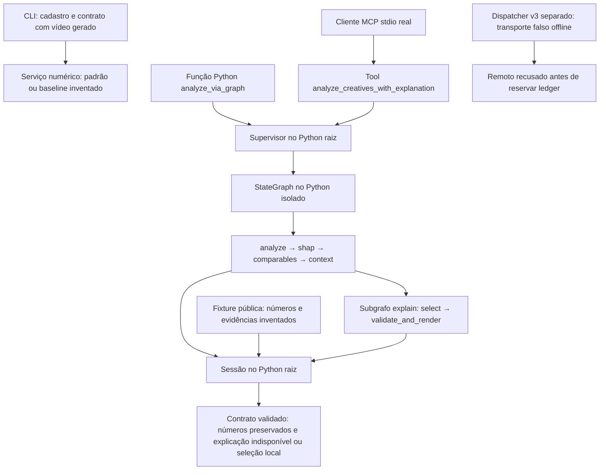

# Issue #7 — reprodução pública offline em ambientes novos

Ensaio local de 20/10/2026, sem fechamento de issue. A instalação completa dos
**dois ambientes novos** foi demonstrada a partir dos locks, seguida de contratos,
CLI, StateGraph/subgrafo compilados e cliente/servidor MCP stdio reais. Os dados,
previsões, features, SHAP e comparáveis usados nessas provas são inventados.
Não houve extração, treino, carregamento de pesos ou inferência de modelo/provedor.

Este documento é aditivo. O [guia anterior](guia-reproducao-local.md), briefing,
README alheio não rastreado e recibos históricos foram preservados. O
[recibo público estruturado](evidence/issue-7-reproducao-offline-20261020.json)
contém comandos, códigos de saída, versões instaladas, hashes públicos e os
resultados sanitizados. O [verificador de protocolo](verification/issue7_public_smoke.py)
é somente uma prova de aceitação com fixture; não integra o produto.

## Identidade e isolamento

| Item | Valor conferido |
| --- | --- |
| Commit-base | `e36f273362b775a9f30b55d01e1d1d611c4be3d8` |
| Árvore-base | `b6fa7510bfef804c01c9e566d9042760ea42f1e8` |
| Clone independente | `${CLONE}` |
| Python já instalado, fora de qualquer venv | CPython 3.11.13, Linux x86_64 |
| Gerenciador | uv 0.11.16 |
| SHA256 de `uv.lock` | `7dea78899c753f7c053cc1178c9c092f7313da7b65012b0138042446c2a161f2` |
| SHA256 de `orchestration/uv.lock` | `65a75e5469d6aace7980a137ce35862624c7d64b21b74aa502a7dd7f1607a5b1` |

Foram usados `git clone --no-local --no-checkout` e checkout detached do commit
exato. Não há alternates nem inodes de objetos Git compartilhados. Antes da
instalação não havia `.venv`, `.env`, README, dados privados, mídia ou pesos no
clone. Os 342 arquivos rastreados da base continuaram byte a byte iguais; só os
novos arquivos desta entrega foram acrescentados. A árvore principal permaneceu
no commit-base, com somente o README não rastreado em seu status.

Os comandos do ensaio rodaram com Bubblewrap: filesystem do host somente
leitura, clone gravável, `/dev` próprio e namespace de rede isolado. O ambiente
foi reconstruído por lista permitida, sem chaves, proxies ou tracing herdados;
`HF_HUB_OFFLINE=1`, `TRANSFORMERS_OFFLINE=1`, tracing desativado e bytecode
desativado. O interpretador-base e os arquivos dos caches foram apenas lidos.
As novas venvs usam esse Python-base; não reutilizam pacotes das venvs originais.

Havia cerca de 7,5 GiB livres no volume de `${CLONE}` antes da instalação e 5,4 GiB ao fim.
Não foram duplicados os cerca de 2 GiB de arquivos do cache: copiaram-se somente
metadados, com referências de leitura aos arquivos extraídos já disponíveis.
`--link-mode copy` criou arquivos independentes nas novas venvs. Foram conferidos
32.399 arquivos regulares de site-packages raiz e 2.005 isolados: nenhum com
mais de um hardlink ou symlink de pacote apontando para fora da própria venv.
Os metadados originais inventariados mantiveram tamanho, mtime e ctime; o host
ficou sob montagem somente leitura durante as instalações e provas.

## Instalação e comandos reproduzidos

Os caminhos foram parametrizados para publicação. Antes dos comandos, definir
as variáveis de ambiente `SOURCE` (checkout original somente leitura), `CLONE`
(destino novo), `BASE_PYTHON` (executável CPython 3.11 fora de venv), `UV`
(executável uv), `ROOT_CACHE` e `GRAPH_CACHE` (caches já populados dos respectivos
locks). Os valores concretos usados estão no ledger local ignorado.
Em outra máquina, ajustar somente esses caminhos. Não obter
pacotes/pesos pela rede, atualizar versões ou reconstruir sdists para contornar
uma falta. Sem os caches correspondentes, registrar pacote/URL/código de saída;
a instalação offline não está garantida em qualquer máquina.

```sh
rtk proxy git clone --no-local --no-checkout "$SOURCE" "$CLONE"
rtk proxy git -C "$CLONE" checkout --detach e36f273362b775a9f30b55d01e1d1d611c4be3d8
```

A segunda linha fixa a base pública. Para executar o novo verificador deste
adendo, aplicar também o commit local da documentação entregue pela coordenação.
Não sobrescrever um clone ou diretório de saída já existente.

Os caches de origem foram `${ROOT_CACHE}` para a raiz e
`${GRAPH_CACHE}`
para o projeto isolado, conforme o [registro da instalação original](issue-5-stategraph-isolado.md).
A preparação efetiva utilizou `shutil.copytree(..., symlinks=True)` apenas em
`wheels-v6` e uma referência `archive-v0` ao cache correto. A estrutura completa
é necessária: copiar só `wheels-v6` produz uma falsa aparência de falta de cache.
Nunca copiar os ambientes originais para suprir essa estrutura.

A partir do diretório raiz do clone, esta é a preparação mínima equivalente à
estrutura final usada, em destinos novos:

```python
from pathlib import Path
import os
import shutil

root = Path(os.environ['CLONE'])
for origin, name in [
    (Path(os.environ['ROOT_CACHE']), 'repro-uv'),
    (Path(os.environ['GRAPH_CACHE']), 'repro-graph-uv'),
]:
    target = root / '.cache' / name
    target.mkdir(parents=True)
    shutil.copytree(origin / 'wheels-v6', target / 'wheels-v6', symlinks=True)
    (target / 'archive-v0').symlink_to(origin / 'archive-v0', target_is_directory=True)
```

Executar a instalação com o cache original visível somente para leitura e o
cache de metadados do clone gravável. No ensaio, o invólucro Bubblewrap adicionou
`--ro-bind / /`, `--bind CLONE CLONE`, `--dev /dev`, `--unshare-net`,
`--die-with-parent`, `--clearenv`, variáveis permitidas e `--chdir` explícito.
Os argv e ambientes completos estão no recibo. Os comandos internos efetivamente
executados foram os seguintes, com cwd respectivamente raiz e `orchestration/`:

```sh
rtk proxy env UV_CACHE_DIR="$CLONE/.cache/repro-uv" "$UV" sync --frozen --offline --no-python-downloads --python "$BASE_PYTHON" --link-mode copy --no-build
rtk proxy env UV_CACHE_DIR="$CLONE/.cache/repro-graph-uv" "$UV" sync --frozen --offline --no-python-downloads --python "$BASE_PYTHON" --link-mode copy --no-build
```

**Resultado completo:** 130 distribuições raiz em 5,275 s e 42 isoladas em
0,173 s; ambos com exitcode 0. Uma conferência posterior `uv sync --check
--frozen --offline --no-python-downloads --python PYTHON_BASE` confirmou os dois
sem mudanças. Os inventários completos estão no recibo. Algumas versões diferem
entre os projetos, por desenho dos locks; não misturar seus site-packages.

| Dependência | Raiz | Orquestração |
| --- | --- | --- |
| FastMCP / MCP | 4.1.0 / 2.3.0 | Ausentes |
| LangGraph | Ausente | 1.2.16 |
| Pydantic / pytest | 2.14.1 / 8.4.2 | 2.14.1 / 8.4.2 |
| PyTorch / torchvision | 2.8.0+cpu / 0.23.0+cpu | Ausentes |
| CatBoost / LightGBM | 1.2.10 / 4.7.0 | Ausentes |
| websockets | 17.2 | 16.1.1 |

O invólucro de execução é parte da prova: os comandos `env` acima, isoladamente,
ativam o modo offline do uv, mas não montam o host somente leitura. Reproduzir
as mesmas condições Bubblewrap descritas e registradas ao acessar os caches.

### Falhas de preparação preservadas

A primeira tentativa saiu com código 2 ao consultar o Python: `Permission
denied`, antes de criar a venv. O mesmo interpretador executou `-V`; a consulta
uv passou após fornecer `/dev` próprio ao sandbox, sem modificar permissões
do host. Uma tentativa posterior raiz saiu com código 1 citando
`torch==2.8.0+cpu`: faltava a referência ao diretório `archive-v0` na preparação
local. Após completá-la, a instalação passou. Isso não demonstra pacote ausente.

O primeiro sync isolado, ainda apontado para os metadados do cache raiz, saiu
com código 1 citando `zstandard==0.25.0`. Uma tentativa de mesclar metadados
falhou em symlink já existente de `iniconfig`; ela foi abandonada em favor de
um destino separado para o cache isolado documentado. O sync com esse cache
passou. Nenhum pacote foi instalado nas tentativas de sync que falharam.

O launcher de ajuda executado dentro de um processo Python adicional recebeu
recusa de namespace do Bubblewrap. A invocação direta do mesmo invólucro passou.
Uma primeira linha de teste isolado foi recusada pelo zsh por colchetes sem
aspas; o teste ainda não havia iniciado. As duas seleções entre aspas executaram
depois uma vez. Esses eventos e códigos permanecem identificados no recibo,
sem convertê-los retrospectivamente em sucessos ou em faltas efetivas de cache.

## Percursos demonstrados

A raiz contém `scripts.creative_cli`, `scripts.creative_mcp` e o serviço numérico.
O serviço integrado compartilhado é
`scripts.explanation_graph_service_v2.analyze_via_graph`; a tool aditiva
`analyze_creatives_with_explanation` chama esse mesmo serviço e conserva
`analyze_creatives`. LangGraph continua exclusivamente no ambiente isolado.



No produto, a sessão padrão usa o handoff M1, SHAP q50 e índice de treino
nativos; essa implementação está documentada na [integração v2](issue-5-integracao-na-arvore-principal.md).
Neste ensaio público, `tests.native_v2_fixture` substitui explicitamente essa
parte por números/evidências inventados. A simulação v3 é uma prova separada,
sem ligação a um provedor no grafo. O diagrama não declara integração remota.

Com cwd na raiz e as duas venvs do clone:

```sh
rtk proxy .venv/bin/python -B -m scripts.creative_cli --help
rtk proxy .venv/bin/python -B -m scripts.creative_cli schema analysis-input
rtk proxy env GALAXIES_GRAPH_PYTHON="$CLONE/orchestration/.venv/bin/python" .venv/bin/python -B -m pytest -q --tb=short --show-capture=no -p no:cacheprovider tests/test_creative_cli.py tests/test_creative_stdio_protocol.py tests/test_explanation_graph_mcp_v2.py::test_real_stdio_and_python_share_graph_service tests/test_explanation_graph_service_v2.py::test_interpreters_import_clone_code_without_environment_installation tests/test_nim_dispatch_v3.py::test_plan_is_fixed_and_remote_blocked tests/test_nim_dispatch_v3.py::test_remote_parent_is_blocked_before_reservation tests/test_nim_dispatch_v3.py::test_a_local_zero_cost_boolean_and_seal_are_insufficient
rtk proxy .venv/bin/python -B -m docs.verification.issue7_public_smoke --output-dir data/private/issue-7-repro-offline/public-protocol
```

O último comando exige diretório novo; depois de uma execução, escolher outro
nome sem apagar o recibo anterior. Inspeciona cada linha do stdout bruto como
JSON-RPC 2.0, inicializa/lista tools/chama o servidor e confere igualdade integral
com a função Python usando um payload válido de três IDs inventados. Foram três
mensagens JSON-RPC, servidor com exitcode 0, scratch vazio e sentinela de brief
inventado ausente no resultado e stderr. A versão pública final deste
verificador passou em 7,408 s; seu protótipo anterior também passou e permanece
separado no ledger. Não são testes adicionais de percepção.

Com cwd em `orchestration/`:

```sh
rtk proxy env GALAXIES_ROOT_PYTHON="$CLONE/.venv/bin/python" .venv/bin/python -B -m pytest -q --tb=short --show-capture=no -p no:cacheprovider 'tests/test_integrated_graph_v2.py::test_real_graph_and_root_session_validate_closed_selection[valid-3]' 'tests/test_integrated_graph_v2.py::test_real_graph_and_root_session_validate_closed_selection[wrong_hash-3]'
```

| Prova | Resultado | O que estabelece |
| --- | --- | --- |
| Seleção direcionada raiz | 11 passaram em 35,32 s | CLI/cadastro com vídeo sem conteúdo gerado localmente, erros contratuais, stdout numérico limpo, Python/MCP real em 1/3/5, imports do clone e recusa remota |
| Grafo/subgrafo compilados | 2 passaram em 5,27 s | Seleção local inventada válida aceita, hash inconsistente rejeitado; números preservados |
| Verificador público final | Exit 0 | Payload válido de três IDs, mesmo serviço Python/MCP integrado, stdout bruto somente JSON-RPC, limpeza |
| Conferência das duas instalações | Exit 0 em ambas | Distribuições correspondem aos locks, sem mudanças propostas |

Os seletores locais dos dois testes isolados são callbacks inventados. No
percurso Python/MCP integrado o seletor ficou ausente: `selector_kind=absent`,
`reason_code=transport_not_configured`, `real_provider_verified=false`,
`native_feature_handoff=false` e `adherence_status=not_evaluated`.
A fixture sinaliza `offline_invented_fixture_not_real_m1`. As seleções direcionadas
anteriores de 108/115 testes não foram repetidas; os 13 testes desta unidade
são provas direcionadas em instalações novas, não uma suíte completa do projeto.

### NIM: apenas simulação e recusa

Na raiz, em diretório novo exclusivamente de simulação:

```sh
rtk proxy .venv/bin/python -B -m scripts.nim_dispatch_v3 --offline-case valid --output-dir "$CLONE/data/private/issue-7-repro-offline/nim-simulation"
```

A execução saiu com código 0 em 2,475 s incluindo inicialização. O transporte
falso respondeu HTTP 200 inventado, com seleção fechada aceita pela autoridade
local. O recibo registra `offline_simulation_only=true`, `real_requests=0` e
`retry_allowed=false`; isso não é resposta NVIDIA. O plano permanece
`remote_execution_released=false`, selo remoto `None`, e nenhum ledger remoto
v3 foi criado. Os testes recusaram os entrypoints remotos antes da reserva,
inclusive quando se tenta tratar apenas o selo/booleano local como liberação.

O plano SHA256 continua
`22713f5a7cc5f067ef330470f13f9d0c24698b8002a2c8af5938e2cf8581d9b5`.
O [registro de integração offline](issue-5-nim-v3-integracao-offline.md) e o
[contrato v3](issue-5-nim-dispatch-v3.md) descrevem as fronteiras.
A oferta pública gratuita não prova R$0 para a conta existente; não houve
consulta a conta, chave, saldo, termos ou faturamento, nem envio remoto executado.

## Materiais privados, histórico e limites da entrega

O clone público não inclui M1/A200, coorte, encoders, uploads ou dados observados.
O bundle servido, segundo a [conferência pública de M1](issue-3-conclusao-tecnica-local.md),
é `9dd1c7a2e35e32cf3068395ed8bf2e0561aa4fecded5c31754f981cc13d70d59`;
essa identidade é referência histórica documentada, não recarga feita aqui.
Os [requisitos dos extratores e pesos](issue-1-extratores-e-treino.md),
[treino A](issue-3-treinamento-offline.md), [B-cache](issue-4-experimento-b-resultados.md)
e [guia dos modos](guia-reproducao-local.md) continuam fontes dos procedimentos
existentes. Treino e aquisição não fazem parte deste roteiro de instalação.
Não inventar comando de avaliação final da #6: sua configuração e abertura do
teste reservado continuam pendentes de protocolo e autorização específicos.

A coordenação informou, em conferência GitHub somente leitura nesta passagem,
que #3–#7 seguem abertas e alguns corpos ainda descrevem o stack antigo
(SmolVLM2/Llama ou M1 ainda não treinado). Este adendo usa fontes e locks do
commit-base e os relatórios versionados atuais; não atualizou issues nem
transformou seus textos antigos em evidência do runtime instalado.

O alvo documentado continua views públicas observadas com 30 ≤ idade < 37 dias.
A faixa não tem cobertura validada, o ranking não valida retorno de patrocínio,
e features inventadas não medem percepção ou desempenho científico.
A [V16 selada](issue-4-vlm-v16-resultados.md) não liberou atributos: ambos os
braços falharam no gate, sem candidata ou nova auditoria. Não houve V17, B/C,
mudança de idioma/seleção ou abertura do holdout nesta unidade.

Os recibos de execução ficam ignorados em
`data/private/issue-7-repro-offline/` **do clone**, incluindo falhas iniciais,
JUnit, stdout/stderr de provas inventadas e inventários. Não contêm credenciais,
raws privados ou conteúdo de mídia real. A prova de protocolo terminou com
scratch vazio; recibos e a reserva consumida da simulação são preservados.
MCP stdio reserva stdout ao protocolo; usar esse transporte não autoriza
compartilhamento de arquivos/confidenciais com um host externo. Nenhum upload,
push, publicação ou deploy foi realizado.

A integração disponível tem provas anteriores distintas: features inventadas
com M1/SHAP nativos, e extração real sobre mídia gerada que se absteve de prever.
Esses resultados históricos não foram reexecutados nem atribuídos a este ensaio.
Continuam pendentes demonstração com **três mídias reais distintas autorizadas**,
explicação real validada/aderência, avaliação científica final e explicação/aceite
do aluno. A instalação pública e os contratos estão reproduzidos; #3–#7 e o
projeto não são declarados concluídos.
